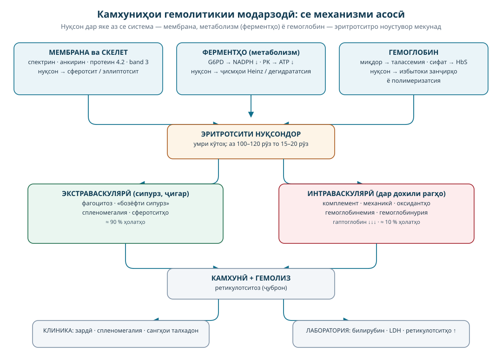
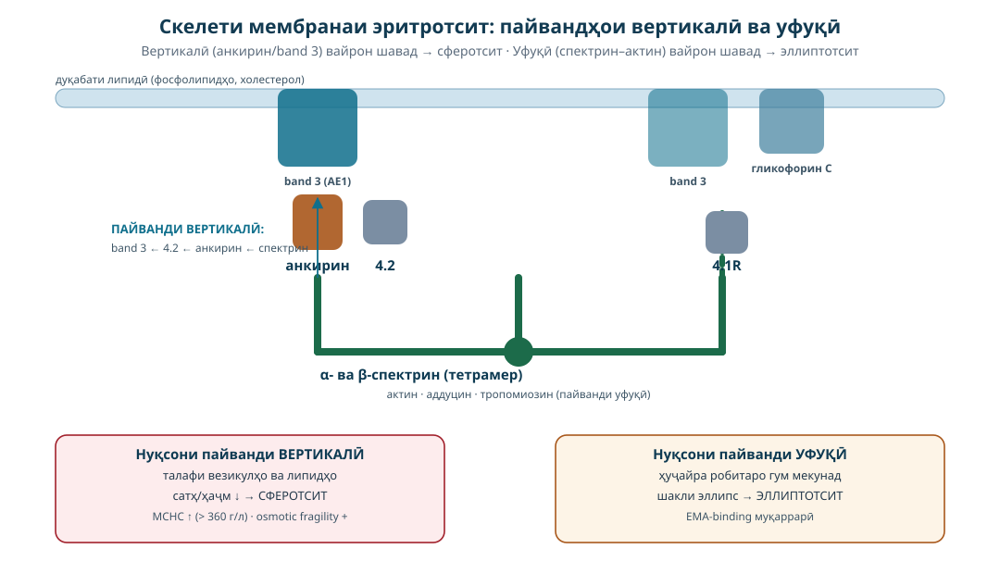
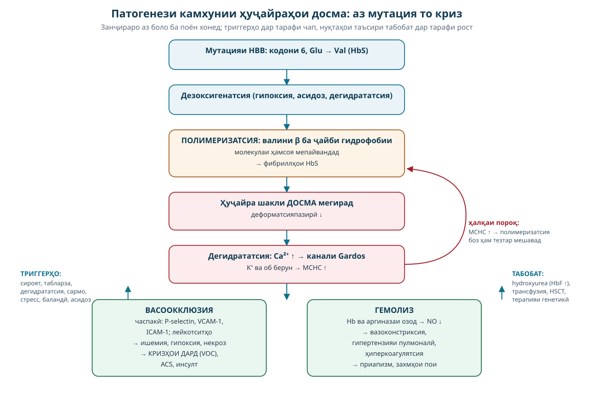

# КАМХУНИҲОИ ГЕМОЛИТИКИИ МОДАРЗОДӢ (ИРСӢ)

## Лексияи 3-соата · Патофизиология, ташхис ва табобат

**Барои донишҷӯёни тиб (курсҳои 3–5) · фанни «Патологическая физиология» + «Бемориҳои дохилӣ / Гематология»**

---

> **Чӣ тавр ин маводро истифода бурдан мумкин аст**
> Лексия ба **3 блоки 45-дақиқавӣ** (ҳамагӣ 135 дақиқа, бо танаффус — тақрибан 150 дақиқа) тақсим шудааст. Ҳар блок дорои: мақсад, мазмуни асосӣ, занҷираи патогенетикӣ, мисолҳои клиникӣ ва саволҳои назоратӣ.
> Ҳар ҷое, ки мебинед **«ЗАНҶИРАИ ПАТОГЕНЕТИКӢ»**, онро бо тирҳо ҳатман аз ёд гиред — ин ҳамин «механизми патогенез» аст, ки дар имтиҳонҳо ва дар назди бемор бештар пурсида мешавад.
>
> ⚠️ **Эзоҳи муҳим:** ин мавод **таълимӣ** аст. Дар амалияи клиникӣ ҳамеша **протоколҳои миллии клиникӣ**, дастурамалҳои расмии доруҳо (масалан, дастури Вазорати тандурустӣ, WHO, TIF, BSH, NCCN) ва маълумоти ҷорӣ дар бораи доруҳоро истифода баред. Миқдорҳои дору дар инҷо танҳо барои фаҳмидани принсипҳост.

---

## 0. НАҚША ВА ҲАДАФҲОИ ЛЕКСИЯ

### 0.1. Мақсади умумӣ
Донишҷӯ бояд фаҳмад, ки **чаро** эритротситҳои шахси гирифтор аз ҳад зуд нобуд мешаванд, **кадом** механизми молекулавӣ дар ҳар як гурӯҳи камхуниҳои гемолитикӣ асосӣ аст ва **чӣ тавр** аз ин механизмҳо барои ташхис ва табобат хулоса баровардан мумкин аст.

### 0.2. Ҳадафҳои мушаххас (бояд ба онҳо расида шавад)
| № | Ҳадаф | Қисми лексия |
|---|-------|--------------|
| 1 | Таърифи камхунии гемолитикӣ ва фарқи он аз камхуниҳои дигар | 1.1–1.2 |
| 2 | Механизмҳои умумии нобудшавии эритротсит (мембранӣ, ферментӣ, глобинӣ, беруназҳуҷайравӣ) | 1.3–1.5 |
| 3 | Фарқи гемолизи **интраваскулярӣ** аз **экстраваскулярӣ** — аз рӯи нишонаҳо ва таҳлилҳо | 1.4 |
| 4 | Мембранопатияҳо: спектрин–анкирин–band 3 ва микросферотситози ирсӣ | 2 |
| 5 | Ферментопатияҳо: роҳи пентозофосфатӣ, NADPH, нуқсони G6PD, фавизм | 3 |
| 6 | Гемоглобинопатияҳо: талассемия ва механизми тавозуни занҷирҳои глобин | 4 |
| 7 | Камхунии ҳуҷайраҳои досма: полимеризатсияи HbS, васоокклюзия, кризҳо | 5 |
| 8 | Алгоритми ташхиси камхунии гемолитикӣ ва тафовути дифференсиалӣ | 6 |
| 9 | Принсипҳои табобат: фолат, гузаронидани хун, хелатотерапия, спленэктомия, терапияи генетикӣ | 7 |

### 0.3. Нақшаи вақт (тайминг)

| Блок | Вақт | Мазмун | Шакли кор |
|------|------|--------|-----------|
| **Блок I** | 45 дақ (дақ. 1–45) | Мафҳумҳо, эритропоэз ва гемолиз, классификатсия, механизмҳои умумӣ, тасвири клиникӣ ва лабораторияи гемолиз | Лексия + таҳлили слайдҳо |
| **Блок II** | 45 дақ (дақ. 50–95) | **Мембранопатияҳо** (микросферотситози ирсӣ, эллиптотситоз, PNH) + **ферментопатияҳо (G6PD, пируваткиназа)** | Лексия + мисоли клиникӣ |
| **Блок III** | 45 дақ (дақ. 100–145) | **Талассемия** + **камхунии ҳуҷайраҳои досма**, алгоритми ташхис, принсипҳои табобат, терапияи генетикӣ, ҷамъбаст | Лексия + ҳалли масъалаҳои ситуатсионӣ |
| Танаффус | 10 дақ | — | — |
| Зиёдатӣ (ихтиёрӣ) | 15–20 дақ | Тестҳои санҷишӣ, саволу ҷавоб | Фаъол |

### 0.4. Мафҳумҳои калидӣ, ки донишҷӯ бояд аз блоки якум донад
**Гемолиз** · **камхунии гемолитикӣ** · **ретикулотситоз** · **гемолизи интраваскулярӣ / экстраваскулярӣ** · **бемории гемолитикӣ (компенсатсияшуда)** · **кризҳои гемолитикӣ** · **спленомегалия** · **билирубини ғайримустақим** · **гаптоглобин** · **ҷисмҳои Heinz** · **сферотсит / эллиптотсит / шизтотсит / ҳуҷайраи досма / target-ҳуҷайра**.

---

## 1. ҚИСМИ УМУМӢ: ГЕМОЛИЗ ҲАМЧУН ҶАРАЁНИ ПАТОЛОГӢ

### 1.1. Таърифҳо ва меъёрҳо

**Камхунӣ (anemia)** — ҳолате, ки дар он миқдори гемоглобин (Hb), шумораи эритротситҳо ва/ё гематокрит аз меъёри синну сол ва ҷинс паст аст. Аз рӯи меъёрҳои WHO:

| Нишондиҳанда | Мардон | Занҳо | Кӯдаки 6–59 моҳ |
|---|---|---|---|
| Гемоглобин, г/л | < 130 | < 120 | < 110 |
| Гематокрит, % | < 40 | < 36 | < 33 |
| Эритротситҳо, ×10¹²/л | < 4,5 | < 4,0 | вазни камтар |

**Камхунии гемолитикӣ (haemolytic anaemia)** — гурӯҳи камхуниҳое, ки **сабаби асосии онҳо кӯтоҳ шудани давомнокии ҳаёти эритротситҳо** (аз 100–120 рӯз то 15–20 рӯз ва камтар) мебошад, на камшавии истеҳсоли онҳо.

> **Қоидаи асосӣ (тавозун):**
> `Камхунии гемолитикӣ = Нобудшавии барвақти эритротситҳо + Эритропоэзи ҷубронкунанда`
> Агар мағзи устухон тавонад ҷуброн кунад (эритропоэз метавонад то **6–8 маротиба** зиёд шавад), камхунӣ намешавад — ин **ҳолати гемолитикӣ (haemolytic state, компенсатсияшуда)** ном дорад. Агар нобудшавӣ аз имкони ҷуброн зиёд бошад — камхунӣ пайдо мешавад.

**Меъёрҳои муҳими физиологӣ (барои муқоиса):**
- Давомнокии ҳаёти эритротсит: **100–120 рӯз**
- Ҳар рӯз тақрибан **1 %** эритротситҳо иваз мешаванд (≈ 2 × 10¹¹ ҳуҷайра дар як рӯз)
- Ретикулотситҳо дар хун: **0,5–1,5 %** (25–75 × 10⁹/л)
- Билирубини умумӣ: **5–20 мкмоль/л**, аз он **ғайримустақим (indirect) — 70–80 %**
- LDH (лактатдегидрогеназа): **< 250 Е/л**
- Гаптоглобин (haptoglobin): **0,3–2,0 г/л** — меъёри лаборатория вобаста аст, лекин **пастшавии он нишони сахеҳи гемолизи интраваскулярӣ** мебошад.
- Ферритин (нишони захираи оҳан): мардон 30–300 мкг/л, занҳо 15–200 мкг/л.

### 1.2. Эритропоэз ва гемолиз — ду паҳлӯи як тавозун

Эритротсит дар давоми ҳаёти худ **ду вазифаи калидӣ** дорад:
1. **Гузаронидани оксиген** — бо гемоглобин (ҳар эритротсит ≈ 270–300 млн молекулаи гемоглобин).
2. **Гузаштан аз ноҳияҳои танг** — шуъбаҳои хунгузари сипурз (диаметри тақрибан 2–3 мкм), ки аз диаметри эритротсит (7–8 мкм) тангтар аст.

Барои иҷрои вазифаи дуюм эритротсит бояд **деформатсияпазир** бошад. Ин қобилият аз 3 омил вобаста аст:

| Омил | Сохтор | Вазифа |
|------|--------|--------|
| **Мембрана** | дуқабати липидӣ + скелети спектринӣ | шакли дутабақавӣ (biconcave), чандирӣ, насосҳои ионӣ |
| **Энергетика** | гликолиз (90 %) ва роҳи пентозофосфатӣ (10 %) | ATP барои насосҳо; NADPH барои ҳимояи антиоксидантӣ |
| **Гемоглобин** | 4 занҷири глобин (2α + 2β) + 4 ҳем | нақли оксиген; сохтори муқаррарии гемоглобин шарти чандирии ҳуҷайра аст |

Агар яке аз ин се система вайрон шавад → эритротсит **пеш аз муддат** нобуд мешавад. Аз ҳамин ҷо **классификатсияи модарзодии камхуниҳои гемолитикӣ** бармеояд:

| Гурӯҳ | Сатҳи нуқсон | Намунаҳо |
|-------|--------------|----------|
| **Мембранопатияҳо** | мембрана ва скелети он | микросферотситози ирсӣ, эллиптотситоз, овалотситоз, ксеротситоз |
| **Ферментопатияҳо (энзимопенияҳо)** | метаболизми ҳуҷайра | нуқсони G6PD, нуқсони пируваткиназа (PK), дигар ферментҳо |
| **Гемоглобинопатияҳо** | сохтор ё синтези глобин | **сифатӣ** — HbS, HbC, HbE (камхунии ҳуҷайраҳои досма); **миқдорӣ** — талассемияҳо |
| **Нуқсонҳои мембранаи аквизитсия** (муқоиса) | PIGA-мутация дар ҳуҷайраҳои бунёдӣ | **гемоглобинурияи шабонаи пароксизмалӣ (PNH)** |

### 1.3. Классификатсияи пурраи камхуниҳои гемолитикӣ

**А. Аз рӯи пайдоиш**

1. **Модарзодӣ (ирсӣ)** — детерминатсияи генетикӣ; аломатҳо аксар вақт аз кӯдакӣ (то 5-солагӣ) зоҳир мешаванд.
2. **Харидашуда (аквизитсия)** — иммунӣ (аутоиммунӣ, аллоиммунӣ, доруворӣ), механикӣ (ТМА, протезҳои дил, *march haemoglobinuria*), сироятии (малярия, сепсис, клостридиалӣ), кимиёвӣ (заҳрҳо: арсин, сулфатҳо, заҳри мор), ТМА/ГУС, бемориҳои ҷигар ва сипурз.

**Б. Аз рӯи ҷои нобудшавӣ**

| Хусусият | **Экстраваскулярӣ** (90 %) | **Интраваскулярӣ** (10 %) |
|---|---|---|
| Ҷои гемолиз | макрофагҳои сипурз, ҷигар, мағзи устухон | дохили рагҳо (комплемент, механикӣ, оксидантҳо) |
| Механизм | фагоцитози қисмӣ/пурра | парчашавии ҳуҷайра дар равонӣ |
| Нишонаҳои муҳим | спленомегалия, зардӣ, сангҳои пигментии талхадон | гемоглобинемия, гемоглобинурия (пешоби тор, ранги чой), дарди камар/шикам |
| Гаптоглобин | муқаррарӣ ё камшавии миёна | **хеле паст / сифр** |
| Нишонаҳои хоси морфологӣ | сферотситҳо, эллиптотситҳо | шизтотситҳо, гемоглобинурия, ҳазми оҳан → гемосидероз |
| Мисолҳо | микросферотситози ирсӣ, талассемия, AIHA | PNH, ТМА/ГУС, клостридиалӣ, malaria, нуқсони вазнини G6PD |

**В. Дараҷаи ҷуброн (дар амалия):**
- **Компенсатсияшуда** — ретикулотситоз, Hb муқаррарӣ;
- **Субкомпенсатсияшуда** — Hb 90–110 г/л;
- **Декомпенсатсияшуда** — Hb < 90 г/л, аломатҳои клиникӣ;
- **Кризҳо** — гемолитикӣ (гемолиз якбора меафзояд), **апластикӣ** (истеҳсол бозмеистад — одатан парвовирус B19), **мегалобластӣ** (камбуди фолат/витамини B12), **секвестратсионӣ** (ҳуҷайраҳо дар сипурз ҳабс мешаванд).



*Расми 1. Се механизми асосии камхуниҳои гемолитикии модарзодӣ: мембрана — ферментҳо — гемоглобин, ва ду роҳи гемолиз (экстраваскулярӣ ва интраваскулярӣ).*

### 1.4. Механизмҳои умумии нобудшавии барвақти эритротситҳо

**Механизми 1. Нуқсони мембрана ва скелети спектринӣ**
> Латви пайвандҳои вертикалӣ (анкирин–band 3, β-спектрин–4.2–band 3) → талафи везикулҳои мембранӣ ва липид → коҳиши нисбати **сатҳ/ҳаҷм (surface/volume ratio)** → ҳуҷайра ба кураи хурд — **сферотсит** табдил меёбад → қобилияти деформатсия гум мешавад → дар капиллярҳои сипурз нигоҳ дошта мешавад → фагоцитоз.
>
> Нуқсони пайвандҳои уфуқӣ (спектрин–актин–4.1R) → ҳуҷайра дарзерии **эллиптотсит**.

**Механизми 2. Нуқсони энергетикӣ ва ионӣ**
> Коҳиши ATP (нуқсони пируваткиназа, гексокиназа) → насосҳои Na⁺/K⁺-ATPase ва Ca²⁺-ATPase бозмеистанд → ҳуҷайра **дегидрататсия** мешавад ё калон мешавад → ҷисмҳои Heinz, сустшавии мембрана → гемолиз. Дар ксеротситоз (PIEZO1/KCNN4) дегидрататсияи зиёд ва MCHC баланд мешавад.

**Механизми 3. Нуқсони ҳимояи антиоксидантӣ**
> Коҳиши NADPH (нуқсони G6PD) → дубора барқарор нашудани **глутатион (GSH)** → ҷамъшавии H₂O₂ ва пероксидҳои липид → оксидшавии гемоглобин (метгемоглобин) → денатуратсия ва пайдоиши **ҷисмҳои Heinz** → пайвандшавӣ ба мембрана → талафи мембрана → «ҳуҷайраҳои газида (bite cells)» → гемолиз.

**Механизми 4. Нуқсони синтези глобин**
> Мутатсия дар гени глобин → (а) **камӣ**: синтези номутавозуни занҷирҳо → избытоки занҷири дигар → пресипитатсия дар дохили эритробластҳо ва эритротситҳо (талассемия); (б) **сифат**: сохтори ғайримуқаррарӣ → полимеризатсия ва сахтшавӣ (HbS).

**Механизми 5. Омилҳои берун аз ҳуҷайра**
> Антителоҳо (IgG/IgM) + комплемент → опсонизатсия ва фагоцитоз/лизис; **механикӣ** — шикастан дар ТМА, фистулаҳои артериовенозӣ, протезҳои дил, фишори баланд (марч гемоглобинурия); **сироятӣ** — малярия (талафи ҳуҷайраҳо), клостридиалӣ (леситини ҳуҷайраҳоро ҳал мекунад); **заҳрҳо** — арсин, сулфатҳо, мис.

**Нақши сипурз — «маҳбаси эритротситҳо»**
Дар сипурз шароити зерин ба нобудшавии ҳуҷайраҳои нуқсондор мусоидат мекунанд:
1. **Кислород ва глюкоза кам** — метаболизм вайрон, pH паст;
2. **Гузаргоҳҳои танг** — ҳуҷайраҳои чандирнашаванда нигоҳ дошта мешаванд;
3. **Макрофагҳо зиёд** — ҳуҷайраҳои опсонизатсияшуда ё мембранаашон вайронро фагоцит мекунанд («бозёфти сипурз» — *splenic conditioning*);
4. Дар натиҷа **спленомегалия** пайдо мешавад (гиперплазияи макрофагҳо), ки худ гемолизро боз ҳам зиёд мекунад — **ҳалқаи пороқ (vicious circle)**.

### 1.5. Тасвири клиникии умумии гемолиз

**Синдромҳои асосӣ:**

| Синдром | Нишонаҳо | Механизм |
|---|---|---|
| Камхунии ҳамвор | заифӣ, хастагӣ, паллидӣ, нафастангӣ ҳангоми ҳаракат, дилхарошӣ | нақли коҳиши оксиген |
| Зардӣ (icterus) ва гипербилирубинемия | зардшавии склераҳо ва пӯст, пешоби торик | гемоглобин → билирубини ғайримустақим |
| Спленомегалия | сипурзи калон дар тарафи чапи шикам | гиперплазияи макрофагҳо + эритропоэзи экстрамедуллярӣ |
| Сангҳои талхадон | сангҳои пигментӣ (билирубинат), дард дар ҳипохондрияи рост | зиёдшавии билирубин дар талхадон |
| Тағйироти устухон | деформатсияҳо, дард | гиперплазияи мағзи устухон (одатан дар талассемия) |
| Кризҳо | табларза, афзоиши камхунӣ, пешоби тор, дард | гемолиз якбора, аплазия, секвестратсия |

**Нишонаҳои хоси ҳар гурӯҳ** (ҳангоми муоина ҳатман ҷустуҷӯ кунед):

| Гурӯҳ | Нишонаҳои хос |
|---|---|
| Микросферотситоз | спленомегалияи зиёд, зардӣ, сангҳои талхадон аз синну соли кӯдакӣ |
| G6PD | кризи шадид 24–72 соат пас аз триггер, гемоглобинурия, дарди пушт |
| Талассемия | чеҳраи «талассемикӣ», гепатоспленомегалия, афзоиши таъхирнок, гемосидероз |
| Досма | кризҳои дард, синдроми синаи шадид, гоҳо инфарктҳо, таваққуфи афзоиш |

### 1.6. Лабораторияи асосии гемолиз (ҳатман аз ёд гиред)

**Триадаи гемолиз:**
1. **Ретикулотситоз** (↑) — ҷуброни мағзи устухон;
2. **Билирубини ғайримустақим ↑** (умумӣ зиёд, аммо ғайримустақим — асосӣ; **директор < 20 %**);
3. **LDH ↑** (аз ҳуҷайраҳои нобудшуда озод мешавад).

**Илова:**
- **Гаптоглобин ↓** — нишони сахеҳи **интраваскулярӣ** (гемоглобин озод гаптоглобинро мебандад ва комплекси гаптоглобин–Hb аз ҷигар тоза мешавад). Дар экстраваскулярӣ муқаррарӣ ё камшавии миёна.
- **Гемоглобинемия ва гемоглобинурия** — танҳо интраваскулярӣ (пешоби «ранги чой», «ранги Coca-Cola»).
- **Ҳемосидеринурия** — баъди гемолиз (ҳазми оҳан дар эпителийи шуъбаҳои пешоб).
- **Ҳуҷайраҳои сипурзии хун (ё гемоглобини сипурзии хун–HbS)** — муқаррарӣ.
- **Нишонаҳои морфологии хун** (ҳатман мазҳари хунро худатон таҳлил кунед!):

| Ҳуҷайра | Нишонаи кӯтоҳ | Асосан дар |
|---|---|---|
| Сферотситҳо | ҳуҷайраи давр, ҳуҷайраи периферии суст, MCHC ↑ | микросферотситози ирсӣ, AIHA |
| Эллиптотситҳо (>25 %) | шакли эллипс | эллиптотситози ирсӣ |
| Шизтотситҳо (фрагментҳо) | шаклҳои нобаробар, «кулоҳ» | ТМА/ГУС, протезҳои дил, DIC |
| Target-ҳуҷайраҳо | «нишони ҳадаф» | талассемия, бемориҳои ҷигар, аспления |
| Ҳуҷайраҳои досма | шакли досма | HbSS, HbSC, HbS/β-талассемия |
| Bite cells (газида) | мембрана «газида шуда» — ҷои ҷисми Heinz | нуқсони G6PD, талафи оксидатсионӣ |
| Ҳуҷайраҳои Howell-Jolly | доғи базофилӣ | аспления/гипоспленизм |
| Ҳуҷайраҳои хуноби соф (базофилии холӣ) | донаҳо/шабакаҳо | талассемия, эритропоэзи зиёд |

**Таҳлилҳои махсус (ки ба мо барои тест-ташхис лозиманд):**

| Таҳлил | Моҳияти он | Дар кадом беморӣ мусбат |
|---|---|---|
| **Осмотикии ноустувории эритротситҳо** (osmotic fragility) | ҳуҷайраҳо дар маҳлули намак камтар устуворанд | микросферотситози ирсӣ |
| **EMA-binding test** (flow cytometry) | пайванди эозин-5-малеимид ба band 3 | микросферотситози ирсӣ (ҳассосият ~ 92–96 %) |
| **Тести ҳассосияти кислота-глицерол (AGLT)** | лизис дар маҳлули кислота-глицерол | микросферотситоз |
| **Фаъолияти ферменти G6PD / PK** | камшавии фаъолият | ферментопатияҳо |
| **Электрофорези гемоглобин / HPLC** | фоизи HbA, HbA₂, HbF, HbS | гемоглобинопатияҳо |
| **Тести гиперлизи метабисулфит / сепаратсияи HbS** | полимеризатсияи HbS | ҳуҷайраи досма (скрининг) |
| **DAT (тест де Кумбс)** | антителоҳо/комплемент дар мембрана | камхуниҳои аутоиммунӣ (на модарзодӣ) |
| **Flow cytometry + FLAER** | набудани CD55/CD59 | PNH |

> 💡 **Қоидаи тиллоии тафовут:** `DAT-мусбат → иммунӣ`, `DAT-манфӣ + ирсӣ → мембрана / фермент / глобин`.

---

# БЛОК II. МЕМБРАНОПАТИЯҲО ВА ФЕРМЕНТОПАТИЯҲО

## 2. МЕМБРАНОПАТИЯҲО (нуқсонҳои мембрана ва скелети эритротсит)

### 2.1. Сохтори мембранаи эритротсит — асоси фаҳмидани патогенез

Мембранаи эритротсит аз се қисм иборат аст:

1. **Дуқабати липидӣ** (фосфолипидҳо, холестерол) — монеаи монеаи интиқоли моддаҳо; манбаи энергия нест, липидҳо бояд мубодила шаванд.
2. **Протеинҳои интегралӣ** (гузаранда): **band 3 (AE1)** — нақли Cl⁻/HCO₃⁻, **гликофоринҳо A/C/D**, Rh, CD47.
3. **Скелети спектринӣ (периферӣ)** — шабакаи зери мембрана, ки шакл ва чандириро таъмин мекунад:
   - **α- ва β-спектрин** (ҳетеродимер → тетрамер);
   - **актин**, **аддуцин**, **тропомиозин**, **дематин** (пайвандҳои уфуқӣ — «junction»);
   - **анкирин** ва **протеин 4.2** — пайвандҳои вертикалӣ, ки скелетро ба band 3 мепайванданд;
   - **протеин 4.1R** — пайванди спектрин–актин ва пайванд ба гликофорин C.

**Схема (содда):**
```
     [band 3]----[4.2]----[анкирин]          <- пайванди ВЕРТИКАЛӢ
        |                    |
        |              [β-спектрин]-[α-спектрин]-[актин]
        |                    |                      |
   [гликофорин C]----[4.1R]---+                      <- пайванди УФУҚӢ
```

> **Қоидаи мнемоникӣ:**
> - **Вертикалӣ (анкирин, band 3, 4.2) вайрон → сферотсит (HS)** — ҳуҷайра мустаҳкамии пайвандро гум мекунад ва аз мембрана «везикулаҳо мепартояд».
> - **Уфуқӣ (спектрин–актин–4.1R) вайрон → эллиптотсит (HE)** — ҳуҷайра аз шакли дутабақавӣ ба эллипс мегузарад, аммо ҳаҷмаш қадре нигоҳ дошта мешавад.



*Расми 2. Скелети мембранаи эритротсит: пайвандҳои вертикалӣ (band 3 – 4.2 – анкирин – спектрин) ва уфуқӣ (спектрин – актин – 4.1R).*

### 2.2. МИКРОСФЕРОТСИТОЗИ ИРСӢ (бемории Минковский–Шоффар, hereditary spherocytosis, HS)

#### 2.2.1. Эпидемиология ва генетика
- Паҳншавӣ: **1 : 2000 – 1 : 5000** дар Аврупои Шимолӣ, Амрико, Қафқоз ва Осиёи Марказӣ; дар Африқою Осиёи Ҷанубу Шарқӣ нисбатан кам.
- **75 % — ирси автосомӣ доминантӣ (АД)**, ~ 25 % — ретсессивӣ ё спорадикии нав (мутацияи *de novo*).
- Генҳо (аз рӯи нақша зиёд ба кам):

| Ген | Протеин | Фоизи мавридҳо | Шиддати клиникӣ |
|---|---|---|---|
| **ANK1** | анкирин | ~ 40–50 % | аксар вазнин |
| **SPTB** | β-спектрин | ~ 20–30 % | вазнин/миёна |
| **SLC4A1** | band 3 | ~ 15–20 % | миёна |
| **EPB42** | протеин 4.2 | ~ 10 % | миёна (дар Ҷопон аксар) |
| **SPTA1** | α-спектрин | кам | **ретсессивӣ**, вазнини зиёд |

#### 2.2.2. Механизми патогенез (аз молекула то бемор)

> **ЗАНҶИРАИ ПАТОГЕНЕТИКӢ (HS):**
> Мутацияи ген (ANK1/SPTB/SLC4A1/EPB42) →
> пайванди номустаҳками анкирин–band 3 ё спектрин глубока (лоҳ) →
> **ноустувории дуқабати липидӣ** →
> талафи везикулҳои мембранӣ ва **коҳиши сатҳи мембрана** →
> нисбати **сатҳ/ҳаҷм паст мешавад** → ҳуҷайра ба **сферотсит** табдил меёбад →
> қобилияти деформатсия аз байн меравад →
> ҳангоми гузаштан аз капиллярҳои танг дар **сипурз** ҳабс мешавад →
> макрофагҳо қисми мембранаро фагоцит мекунанд («conditioning» — «аломатҳои газида») →
> баъд аз чанд гузар **фагоцитози пурра** →
> **гемолизи экстраваскулярӣ** →
> ретикулотситоз + билирубини ғайримустақим ↑ + LDH ↑ + **спленомегалия** →
> **камхунӣ + зардӣ + ҳосилшавии сангҳои пигментии талхадон**.

**Нуктаҳои муҳими патогенетикӣ (барои фаҳмидан):**
1. **Сипурз муҳит аст, на сабаб.** Сабаб — генетикӣ. Агар сипурзро гирем, гемолиз камафзо мешавад, аммо нуқсони мембрана боқӣ мемонад.
2. **Талафи липидҳо ва везикулатсия** — механизми якумдараҷаи ташаккули сферотсит. Аз ҳамин сабаб миқдори мембрана кам, MCHC (консентратсияи Hb дар ҳуҷайра) баланд (**> 360 г/л**) мешавад.
3. Сферотситҳо **осмотики ноустуворанд** — дар маҳлули гипотоникӣ барвақттар (аз 0,5–0,6 % NaCl) ҳамин аст, ки барои ташхис истифода мешавад (osmotic fragility).
4. Дар давоми ҳаёти худ бемор **сангҳои талхадонро** ба таври зиёд ҳосил мекунад: билирубин зиёд → холестерин + билирубинати калсий.

#### 2.2.3. Тасвири клиникӣ

**Триадаи классикӣ:** **камхунӣ + зардӣ + спленомегалия**.

| Шакл | Hb | Ретикулотситҳо | Билирубин | Сипурз | Клиника |
|---|---|---|---|---|---|
| **Носии хомӯш (silent carrier)** | муқаррарӣ | муқаррарӣ | муқаррарӣ | муқаррарӣ | ҳеҷ аломат |
| **Шакли сабук (mild)** | 110–130 г/л | 3–5 % | лез (кам) | муқаррарӣ ё +1 см | зардии сабук, хастагӣ |
| **Шакли миёна** | 80–110 г/л | 5–10 % | зиёд | +2–4 см | зардӣ, спленомегалия, сангҳои талхадон |
| **Шакли вазнин** | < 80 г/л | > 10 % | хеле зиёд | спленомегалияи зиёд | таваққуфи афзоиш, кризҳои мунтазам |

**Кризҳо (муҳим барои экзамен ва амалия):**

| Криз | Ҳангоми | Моҳият | Лаборатория | Табобат |
|---|---|---|---|---|
| **Гемолитикӣ** | сироят, стресс, ҳомиладорӣ | гемолиз якбора меафзояд | Hb ↓, ретикулотситҳо ↑↑, билирубин ↑↑ | гидрататсия, фолат, гузаронидани хун |
| **Апластикӣ** | **парвовирус B19** | вирус эритробластҳоро қатъ мекунад (рецептор — P-антиген) | ретикулотситҳо **< 1 %**, Hb якбора ↓, лейкотсит/тромботсит муқаррарӣ | гузаронидани хун, ҳимоя |
| **Мегалобластӣ** | камбуди кислотаи фолат | ҷуброни зиёд фолатро тамом мекунад | MCV ↑, нейтрофилҳои ҳиперсегментӣ | фолат 1–5 мг/рӯз |
| **Сангҳои талхадон** | синну соли калонтар | пигментатсия | УЗД, дарди коликавӣ | холецистэктомия (агар нишон дошта бошад) |

**Оқибатҳои дер:** сангҳои талхадон, ҳемосидероз (одатан не), таваққуфи афзоиш, оқибати гемотрансфузияҳои такрорӣ (аллоиммунизатсия, сироятҳо, сарбории оҳан).

#### 2.2.4. Ташхис — қадам ба қадам

| Қадам | Таҳлил | Натиҷа дар HS |
|---|---|---|
| 1 | Мазҳари хун (smear) | **сферотситҳо** (ҳуҷайраҳои давр, периферияи суст), MCHC ↑ > 360 г/л |
| 2 | CBC | камхунии нормотситӣ-нормохром, RDW ↑, **MCHC ↑**, ретикулотситоз |
| 3 | Билирубин | ғайримустақим ↑, LDH ↑, гаптоглобин муқаррарӣ |
| 4 | **DAT (Кумбс)** | **манфӣ** (муҳим барои фарқ аз AIHA) |
| 5 | **Осмотикии ноустуворӣ** | **мусбат** (lyse дар 0,5–0,6 % NaCl) — ҳассосият ~ 70–80 % |
| 6 | **EMA-binding test (flow cytometry)** | **мусбат** (пайванди эозин-5-малеимид кам) — ҳассосият ~ 92–96 %, **стандарти тиллои ҷорӣ** |
| 7 | AGLT, криогемолиз, SDS-PAGE спектрин | мусбат / протеини спектрини номутавозун |
| 8 | Таърихи оилавӣ | 75 % — АД: волидон/бародархо гирифторанд |
| 9 | Генетикӣ (NGS) | мутацияи мушаххас (барои маслиҳати генетикӣ ва ташхиси пренаталӣ) |

> ⚠️ **Хатои маъмул:** агар танҳо ба osmotic fragility такя кунед, то 20–30 % беморони HS-ро аз даст медиҳед. **EMA-binding** санҷиши интихоби имрӯз аст.

#### 2.2.5. Тафовути дифференсиалӣ (HS)

| Нишона | HS | AIHA (Кумбс-мусбат) | Талассемия | Нуқсони G6PD |
|---|---|---|---|---|
| DAT | манфӣ | **мусбат** | манфӣ | манфӣ |
| Сферотситҳо | зиёд | зиёд | кам | кам (bite cells) |
| MCHC | **баланд** | муқаррарӣ/баланд | паст | муқаррарӣ |
| MCV | муқаррарӣ | муқаррарӣ | **паст** | муқаррарӣ |
| Таърихи оилавӣ | аксар мусбат | манфӣ | мусбат | мусбат (Х-аллоқаманд) |
| Гемолизин | экстраваскулярӣ | аксар экстраваскулярӣ | экстраваскулярӣ | интраваскулярӣ (криз) |

#### 2.2.6. Табобат

1. **Кислотаи фолат (folic acid) 1–5 мг/рӯз — барои ҳамаи беморони гемолитикӣ** (истеҳсоли зиёди ҳуҷайраҳо фолатро талаб мекунад).
2. **Табобати кризҳо:** гидрататсия, доруҳои зидди сироят (ҳангоми сироят), дар ҳолати вазнин — **гузаронидани эритротситҳо**.
3. **Спленэктомия** — табобати **патогенетикӣ** (ҳалқаи асосии гемолизро мебандад):
   − **Нишонҳо:** камхунии вазнин (Hb < 80 г/л), кризҳои мунтазами гемолитикӣ, таваққуфи афзоиш, сангҳои талхадон, ниёз ба гузаронидани хуни такрорӣ.
   − **Синну сол:** оптималӣ **аз 6-солагӣ боло** (хатари сироятҳои зери сипурзии *encapsulated* дар кӯдакони хурдтар зиёд). Дар кӯдакони хурд **спленэктомияи қисмӣ** (partial splenectomy) ё **эмболизатсияи сипурз** мумкин аст.
   − **Омодагии ҳатмӣ (2–4 ҳафта пеш):** ваксинатсия зидди **пневмококк, Haemophilus influenzae b, менингококк**; баъди амалия **пенитсиллини профилактикӣ** на камтар аз 2 сол (ё то 5-солагӣ; дар баъзе дастурамалҳо — дарозтар), омӯзиши бемор ва волидон, доштани кортикостероидҳо дар хона барои ҳолати табларза.
   − **Оқибатҳо:** камшавии гемолиз ва ниёз ба трансфузия, аммо хавфи сироятҳои вазнин ва тромбозҳо (додани ваксинатсия ва профилактикаро талаб мекунад). Сферотситҳо дар хун **боқӣ мемонанд** (ин аномалияи мембрана аст, на мағзи устухон).
4. **Холецистэктомия** — ҳангоми сангҳои талхадони симптоматикӣ (одатан ҳамроҳ бо спленэктомия).
5. **Маслиҳати генетикӣ** — барои оила.

> 💡 **Барои донишҷӯ:** спленэктомия «шифо» нест — ин **муолиҷаи патогенетикии гемолиз** аст. Баъд аз он камхунӣ кам мешавад, аммо бемор то охири умр дар хавфи сироятҳост ва аз ин рӯ **воксинатсия + пенитсиллин** ҳатмист.

### 2.3. ЭЛЛИПТОТСИТОЗИ ИРСӢ (hereditary elliptocytosis, HE)

- Паҳншавӣ: **1 : 2000 – 1 : 4000**; асосан **ирси автосомӣ доминантӣ**.
- Генҳо: **SPTA1, SPTB, EPB41, EPB42, GYPC, SLC4A1** — аксар вақт нуқсони пайванди **уфуқии** спектрин–актин.
- Патогенез: нуқсони пайванди уфуқӣ → ҳуҷайра ҷисми худро гум мекунад, аммо **мембрана мекӯчад (миқдори липид нигоҳ дошта мешавад)** → эллиптотсит (шакли эллипс/сабз) → эллиптотситҳо деформатсияпазир **ках мебошанд**, вале ба дараҷаи сферотситҳо не → дар бисёр ҳолатҳо гемолиз сабук.
- **Клиника:** 60–70 % — бе аломат; 10 % — гемолизи миёна/вазнин (шакли «пироварди» ҳомиладорӣ, камбуди оҳан ё сироятро бадтар мекунад); кӯдаконе, ки ҳангоми таваллуд гемолизи вазнин доранд (HPP — hereditary pyropoikilocytosis).
- **Ташхис:** дар мазҳари хун **> 25 % эллиптотситҳо** (меъёр < 1 %); **EMA-binding муқаррарӣ** (ин фарқи калидӣ аз HS!); osmotic fragility муқаррарӣ ё кам; таърихи оилавӣ; генетикӣ.
- **Табобат:** аксар вақт ҳеҷ; фолат; дар шаклҳои вазнин — спленэктомия (натиҷа камтар аз HS); пешгирӣ аз ҳолатҳое, ки гемолизро бадтар мекунанд.
- **Шаклҳои хос:** *Hereditary pyropoikilocytosis (HPP)* — мембрана дар 45–46 °C нобуд мешавад (мутасияи SPTA1); *Southeast Asian ovalocytosis (SAO)* — мутацияи SLC4A1, одатан бе гемолиз, аммо аз малярияи тропикӣ ҳимоя мекунад.

### 2.4. Дигар мембранопатияҳо (барои мукаммалӣ)

| Беморӣ | Ген/нуқсон | Хусусиятҳои асосӣ | Табобат |
|---|---|---|---|
| **Овалотситоз (SO)** | SLC4A1 (band 3) | овалотситҳо, MCHC ↑, гемолизи миёна, баъзан гиперкалиемия | фолат, спленэктомия (кам) |
| **Стоматситоз** | SLC4A1, PIEZO1 | стоматситҳо стоматситҳо дар мазҳари хун; гемолизи сабук | фолат |
| **Ксеротситоз ( dehydrated hereditary stomatocytosis, DHS)** | **PIEZO1, KCNN4** | дегидрататсия, **MCHC ↑↑ (> 400 г/л)**, гемолизи миёна, **периферияи гиперкалиемия ва псевдогиперкалиемия** | **спленэктомия манъ!** (хавфи тромбози шадид, гиперкоагулятсия) |
| **Акантотситоз** | нуқсони мембрана + липидҳо (abetalipoproteinemia, McLeod, сироз) | акантотситҳо («хари»), гемолиз, неврология | табобати бемории асосӣ, витаминҳои равғанҳалшаванда |

### 2.5. ГЕМОГЛОБИНУРИЯИ ШАБОНАИ ПАРОКСИЗМАЛӢ (PNH) — мисоли нуқсони аквизитсияи мембрана

Хоҳ ин беморӣ **модарзодӣ нест**, гузоштан муҳим аст, чун дар тафовути дифференсиалӣ ҳамеша ҳозир аст ва механизми муқоисавӣ медиҳад.

- **Мутацияи PIGA** дар ҳуҷайраи бунёдии гемопоэтикӣ (аквизитсия, соматикӣ) → набудани протеинҳои **GPI-анкордор** → набудани **CD55 (DAF) ва CD59 (MIRL)** → комплемент (C3, C5b-9) ҳуҷайраро ҳал мекунад.
- **Триадаи клиникӣ:** (1) **гемолизи интраваскулярӣ** бо гемоглобинурияи шабона (пешоби тор), (2) **тромбозҳо** (синусҳои ҷигар — Budd–Chiari, тромбози равонҳои калон), (3) **цитопения ва аплазияи мағзи устухон**.
- **Ташхис:** flow cytometry — набудани CD55/CD59 дар гранулотситҳо/эритротситҳо; **FLAER** — санҷиши ҳассос.
- **Табобат:** **экулизумаб, равулизумаб** (ингибиторҳои C5), **пегцетакоплан** (ингибитори C3), **иптакопан** (ингибитори фактори B — даҳонӣ); антикоагулятсия; HSCT; ваксинатсия зидди менингококк **ҳатмӣ** пеш аз ингибиторҳои комплемент.

---

## 3. ФЕРМЕНТОПАТИЯҲО: НУҚСОНИ ГЛЮКОЗО-6-ФОСФАТ ДЕГИДРОГЕНАЗА (G6PD)

### 3.1. Роҳи пентозофосфатӣ ва нақши NADPH — асоси патогенез

Дар эритротсит (ҳуҷайрае, ки ҳаста надорад) мубодилаи моддаҳо танҳо аз ҳисоби **гликолиз (90 %)** ва **роҳи пентозофосфативӣ (HMP, 10 %)** меравад.

**Роҳи HMP:**
```
Глюкоза-6-фосфат ──[G6PD]──► 6-фосфоглюконолактон
                       │
                       └── NADP⁺  →  NADPH   ← «шакли барқароршудаи NADP»
                                  │
NADPH ──[глутатионредуктаза]──► GSSG → GSH (глутатион барқарор)
                                  │
   H₂O₂ / пероксидҳои липид ──[глутатионпероксидаза/каталаза]──► H₂O + O₂ + H₂O
```

> **Се ҷумлаи калидии патогенез:**
> 1. **G6PD** — қадами маҳдудкунандаи роҳи HMP ва **ягона манбаи NADPH** дар эритротсит.
> 2. **NADPH** глутатионро барқарор мекунад; **GSH** — антиоксиданти асосии эритротсит.
> 3. Агар G6PD кам бошад, ҳуҷайра **ҳангоми стресси оксидатсионӣ** наметавонад пероксидҳоро нест кунад → гемолиз.

### 3.2. Генетика ва эпидемиология

- **Ген G6PD** дар **хромосомаи X (Xq28)** ҷойгир аст → ирс **Х-аллоқаманди ретсессивӣ**.
  - **Мардон (XY):** як аллели нуқсондор кофист → **бемор**.
  - **Занҳо (XX):** носии ҳетерозиготӣ → одатан носи, аммо бинобар **инактиватсияи тасодуфии хромосомаи X (lyonisation)** метавонанд шаклҳои сабук/миёна дошта бошанд.
  - Аз ин ҷо: **духтарон низ метавонанд бемор шаванд** — ин хатои маъмули донишҷӯён аст.
- Паҳншавӣ: **> 400 млн одам дар ҷаҳон**; минтақаҳои маляриянок — **Африқои Субсаҳара, Ҳавзаи Баҳри Миёназамин (Юнон, Сардиния, Қибрис), Ховари Миёна, Ҳиндустон, Осиёи Ҷанубу Шарқӣ, Ҷануби Чин**. Дар Осиёи Марказӣ ва Қафқоз низ вохӯрдан мумкин, аммо скрининг ва маълумоти оморӣ нопурра аст.
- **> 200 варианти аллелӣ** маълум аст. Муҳимтаринҳо:

| Вариант | Фаъолияти фермент | Паҳншавӣ | Хусусият |
|---|---|---|---|
| **G6PD B (муқаррарӣ)** | 100 % | ҳама | солим |
| **G6PD A⁻ (African)** | ~ 10–15 % | Африқо | гемолизи шадид, аммо одатан сабуктар |
| **G6PD Mediterranean** | < 1–10 % | Миёназамин, Осиёи Марказӣ | гемолизи вазнин, фавизм ва доруҳо хеле хатарнок |
| **G6PD Canton, Kaiping, Viangchan** | < 10 % | Чин, Осиёи Ҷанубу Шарқӣ | гемолизи вазнин |
| **G6PD Mahidol** | ~ 10 % | Мянма, Таиланд | гемолизи миёна |

### 3.3. Классификатсияи WHO (аз рӯи фаъолият)

| Класс | Фаъолияти фермент | Клиника |
|---|---|---|
| **Класс I** | < 10 % | **гемолизи хроникии ғайрикураии (CNSHA)** — гемолиз доимӣ, аксар вақт вазнин, ба спленэктомия эҳтиёҷ |
| **Класс II** | < 10 % | гемолизи **шадиди интермиттент** (фавизм, доруҳо, сироят) — вазнин |
| **Класс III** | 10–60 % | гемолизи шадид, одатан сабук/миёна (масалан A⁻) |
| **Класс IV** | 60–100 % | бе аломат |
| **Класс V** | > 100 % | зиёд — полиситемия (хеле нодир) |

### 3.4. МЕХАНИЗМИ ПАТОГЕНЕЗ (пурра)

> **ЗАНҶИРАИ ПАТОГЕНЕТИКӢ (G6PD):**
> Мутацияи гени G6PD (Х-аллоқаманд) →
> фаъолияти фермент паст мешавад → **камии NADPH** →
> глутатион (GSH) барқарор **на**мешавад →
> бо таъсири **стресси оксидатсионӣ** (пероксидҳо, радикалҳои озод, доруҳо/лӯбиё) →
> **H₂O₂ ва пероксидҳои липид ҷамъ мешаванд** →
> оксидшавии гемоглобин → **метгемоглобин** +
> денатуратсия ва пресипитатсияи гемоглобин → **ҶИСМҲОИ HEINZ** (донаҳои базофилӣ дар дохили эритротсит) →
> ҷисмҳои Heinz ба мембрана мепайванданд → мембранаи ҳуҷайра «газида мешавад» (**bite cells**) →
> **(а)** фагоцитоз дар сипурз (экстраваскулярӣ) +
> **(б)** ҳал шудани ҳуҷайраҳо дар равонӣ (**гемолизи интраваскулярӣ**) →
> гемоглобинемия → **гемоглобинурия** (пешоби тор) → хавфи **оқибатҳои гурда (AKI)** ва
> ретикулотситоз, билирубин ↑, LDH ↑, гаптоглобин ↓ →
> **камхунии гемолитикӣ**.

> ⚠️ **Чаро криз худаш қатъ мешавад?** Ретикулотситҳои нав (ҳуҷайраҳои ҷавон) фаъолияти G6PD-и нисбатан баланд доранд — онҳо ҷои эритротситҳои нобудшударо мегиранд ва Hb бо тартиб барқарор мешавад (одатан **7–10 рӯз**), агар триггер қатъ карда шавад.

### 3.5. ТРИГГЕРҲО (омилҳои барангезанда) — ҷадвали ҳатмии ёдгирӣ

| Гурӯҳ | Намунаҳо |
|---|---|
| **1. Доруҳо** (оксидантҳо) | **Примаквин, памаквин, тафенохин** (зидди малярия), **дапсон**, **нитрофурантоин**, **сулфаниламидҳо, сулфадоксин-пириметамин (котримоксазол, сулфасалазин)**, **хлорохин** (дар миқдори калон), **метиленсиний**, **толуидин, нидалиний, фенилазопиридин**, **аспирин** (> 1 г/рӯз), **кислотаи аскорбинӣ дар миқдори калон**, **доксорубицин**, **даунорубицин**, **витамини K (менадион)** |
| **2. Хӯрок** | **Лӯбиёи бақилла (Vicia faba — фавизм)**, бахусус лӯбиёи хом ё хушкида; маҳсулоти лӯбиё ҳангоми гуруснагӣ |
| **3. Сироятҳо** | **40–50 % ҳолатҳо**: гепатити A/B/E, пневмония, семпсис, mononukleoz, грипп, typhoid, сироятҳои роҳҳои пешоб, COVID-19 |
| **4. Ҳолатҳои дохилӣ** | **кетоацидози диабетӣ**, гипергликемия, неонаталии иктерус, гипоксия, инфаркт, ҳомиладорӣ, гурухнагӣ |
| **5. Заҳрҳо/моддаҳо** | нафталин (кураҳои зидди мӯрча), ҳеннӣ (барои ранги мӯй — русуми маъмули шарқӣ!), доруҳои зидди вараҷа дар миқдори зиёд, шарбати лӯбиё |

> 💡 **Барои беморон:** «Ҳамеша аз духтур пурсед, ки ин дору барои ман хатарнок аст ё не», ба ҳамроҳ доштани рӯйхати доруҳои манъшуда, **ҳеннӣ ва нафталинро истифода набаред**, ҳангоми табларза ва заъфият фавран муроҷиат кунед.

### 3.6. ТАСВИРИ КЛИНИКӢ

1. **Шакли неонаталӣ:** зардӣ (neonatal jaundice) дар 1–3 рӯзи аввали ҳаёт; хавфи **kernicterus (эҳтибоси билирубин дар майна)** — ин нишонаи аввалини бисёр кӯдакон аст.
2. **Кризи гемолитикии шадид** (одатан мардон, 1–3 рӯз пас аз триггер):
   - заифии шадид, паллидӣ, зардӣ;
   - **дарди пушт ва шикам** (дар натиҷаи инфарктҳои хурди равонӣ ва ишемия);
   - **гемоглобинурия** — пешоб ранги чой/ранги Coca-Cola, олигурия;
   - табларза, дилхарошӣ, тахикардия, нафастангӣ;
   - Hb метавонад то **40–60 г/л** поён равад.
3. **Шакли хроникӣ (класс I):** гемолизи доимӣ, спленомегалия, зардии пӯст, сангҳои талхадон.
4. **Шакли компенсатсияшуда:** Hb муқаррарӣ, ретикулотситҳо камшавии миёна — дар сафари зиндагӣ тасодуфан дарёфт мешавад.

### 3.7. ТАШХИС

| Таҳлил | Натиҷа |
|---|---|
| Анамнез (МУҲИМ!) | миллат/минтақаи пайдоиш, хӯрдани лӯбиё, доруҳо, сироят, ҳолати кӯдакӣ, таърихи оилавӣ (духтарон, падарон) |
| CBC | камхунии нормохром-нормотситӣ, ретикулотситоз (пас аз 3–5 рӯз) |
| Мазҳари хун | **bite cells**, ҷисмҳои Heinz (бо ранги суправиталии кристалӣ виолет — **дар дохили ҳуҷайра**) |
| Биохимия | билирубини ғайримустақим ↑, LDH ↑, гаптоглобин ↓, **гемоглобинемия ва гемоглобинурия** |
| Пешоб | гемоглобинурия (дипстик: хуни + , эритротситҳо кам), ҳемосидеринурия 3–5 рӯз баъд |
| **Фаъолияти G6PD** | **паст** (нормалӣ ~ 7–10 Е/г Hb) — ⚠️ **дар давраи криз ва то 2–3 моҳ баъд аз он метавонад муқаррарӣ бошад!** (ретикулотситҳо ва лейкотситҳо G6PD-и зиёд доранд) — баъд аз 2–3 моҳ такрор кунед |
| Скрининги флюоресцентӣ | NU (nucleotide) — скрининги тез |
| Генетикӣ | мутацияи мушаххас (барои маслиҳати оилавӣ, ташхиси пренаталӣ) |
| Тафовут | PK-нуқсон, талассемия, AIHA (DAT), сирояти шадид, ТМА |

> ⚠️ **Хатои маъмули ташхисӣ:** ташхиси фаъолияти G6PD дар авҷи криз → натиҷаи **фалсафии манфӣ**. Ҳамеша баъд аз 3 моҳ такрор кунед ё генетикӣ тасдиқ кунед.

### 3.8. ТАБОБАТ ВА ПЕШГИРӢ

**Асос: манъи триггерҳо (пешгирӣ) муҳимтар аз табобат аст.**

Табобати кризи шадид:
1. **Қатъ кардани триггер** (дору, лӯбиё) ва табобати сироят.
2. **Гидрататсия ва пешобравӣ (форсированная диурез)** — барои пешгирии осеби гурда аз гемоглобинурия; назорати креатинин ва К⁺.
3. **Трансфузияи эритротситҳо** — ҳангоми **Hb < 70 г/л** ё вайроншавии ҳолати умумии бемор (тахикардия, нафастангӣ, синкопе).
4. **Табобати гипербилирубинемияи неонаталӣ:** фототерапия; ҳангоми зарурат — **exchange transfusion**; назорати сахти билирубин.
5. **Кортикостероидҳо — бемаънӣ** дар нуқсони G6PD (ҳуҷайра «муқобил» нест, механизм ирсӣ аст).
6. Дар шаклҳои хроникӣ (класс I): кислотаи фолат; спленэктомия танҳо дар ҳолатҳои истисноӣ.
7. **Маслиҳати генетикӣ ва скрининги хешовандони мард.**

**Рӯйхати манъшуда барои бемор** (бояд ба бемор дода шавад): примаквин, дапсон, нитрофурантоин, сулфаниламидҳо, лӯбиё, нафталин, ҳеннӣ, кислотаи аскорбинӣ дар миқдори калон, аспирин дар миқдори калон.

### 3.9. Муқоиса: нуқсони ПИРУВАТКИНАЗА (PK)

- Ирс: **автосомӣ ретсессивӣ** (гени PKLR).
- Механизм: камшавии ATP → насосҳои Na⁺/K⁺ ва Ca²⁺ бозмеистанд → дегидрататсия/талафи мембрана → гемолизи хроникии **неонаталӣ ва доимӣ**.
- Клиника: зардӣ аз кӯдакӣ, спленомегалия, сангҳои талхадон, таваққуфи афзоиш; **ҷисмҳои Heinz хеле кам** (механизм дигар аст: нуқсони энергия, на оксидатсионӣ).
- **Ташхис:** фаъолияти PK паст; **фаъолияти PK дар ретикулотситҳо нисбатан баланд аст — баҳо ҳатман бо дарназардошти шумораи ретикулотситҳо сурат гирад**.
- **Табобат:** **митапиват (Pyrukynd / Aqvesme) — активатори PK** (аз соли 2022 дар ИМА барои нуқсони PK тасдиқ шудааст; аз декабри 2025 барои **талассемияи α ва β** низ тасдиқ шудааст — ин навтарин дастовард аст); фолат; спленэктомия; HSCT; терапияи генетикӣ дар таҳқиқот.


---

# БЛОК III. ТАЛАССЕМИЯ ВА КАМХУНИИ ҲУҶАЙРАҲОИ ДОСМА

## 4. ТАЛАССЕМИЯ (гемоглобинопатияи МИҚДОРӢ)

### 4.1. Гемоглобин: сохтор ва рушд — асоси фаҳмидан

**Сохтори гемоглобин:**
```
Гемоглобин = 4 занҷири глобин (глобула) + 4 гем (оҳан + порфирин)
            └── 2 занҷири α (хромосомаи 16)  +  2 занҷири β-монанд (хромосомаи 11)
```
Ҳар занҷир 141 (α) ё 146 (β) аминокислота дорад; **гем** оксигенро мебандад.

**Таҳаввули гемоглобин дар давоми ҳаёт (switching):**

| Даврони ҳаёт | Гемоглобини асосӣ | Таркиб | Ҷои истеҳсол |
|---|---|---|---|
| Ҷанин (то 8 ҳафта) | Hb Gower, Hb Portland | ζ₂ε₂, ζ₂γ₂ | халтаи зардии ҷанин (yolk sac) |
| Ҷанин (8 ҳафта – таваллуд) | **HbF** | **α₂γ₂** | ҷигар ва сипурзи ҷанин |
| Баъд аз таваллуд | **HbA (асосӣ, > 95 %)** | **α₂β₂** | мағзи устухон |
| Калонсолон (миқдори кам) | **HbA₂ (2–3,5 %)** | **α₂δ₂** | мағзи устухон |
| Калонаон (онтогенез) | HbF (< 1 %) | α₂γ₂ | мағзи устухон |

> **Ин ҷадвал калиди фаҳмидани клиника аст:**
> - **Талассемияи β** одатан аз **3–6-моҳагӣ** зоҳир мешавад — вақте ки ивазшавии γ → β анҷом меёбад (то он вақт HbF ҷуброн мекунад).
> - **Камхунии ҳуҷайраҳои досма** низ аз **4–6-моҳагӣ** сар мешавад (то он вақт HbF полимеризатсияро бозмедорад).
> - **Талассемияи α** метавонад ҳатто дар давраи ҷанинӣ зоҳир шавад (Hb Bart's — α₂ недорад, ҳуҷайраҳои ҷанин ҳал мешаванд).

**Кластерҳои генҳо:**

| Кластер | Хромосома | Генҳо | Муҳимият |
|---|---|---|---|
| **α-кластер (HBA1, HBA2)** | **16 (16p13.3)** | ζ, α2, α1, θ | **2 гени α дар ҳар як хромосома** → ҳамагӣ **4 гени α** |
| **β-кластер (HBB)** | **11 (11p15.4)** | ε, γG, γA, δ, **β** | 1 гени β дар ҳар хромосома → **2 гени β** |

> 💡 Аз ин ҷо **логикаи геометрия** барои талассемияи α: агар 1, 2, 3 ё 4 гени α аз байн равад, шаклҳои клиникӣ **мутаносибан** ба дараҷаи нуқсон ташаккул меёбанд.

**Намудҳои мутатсияҳо:**

| Талассемия | Навъи мутация | Мисолҳо |
|---|---|---|
| **α** | асосан **делесияҳо** (гени пурра нест мешавад) | --SEA, --FIL, -α3.7, -α4.2 |
| **α (Ғайриделистӣ)** | мутатсияҳои нуқтавӣ | Hb Constant Spring, Hb Quong Sze |
| **β** | асосан **мутатсияҳои нуқтавӣ** (делесияҳо каманд) | мутацияҳои промотер, splicing (IVS1-110), nonsense (Codon 39, β0), frameshift (Codon 41/42) |
| **Натиҷа** | **β⁰** — занҷири β тамоман нест; **β⁺** — кам истеҳсол мешавад | — |

### 4.2. МЕХАНИЗМИ ПАТОГЕНЕЗ (талассемия) — муҳимтарин қисми лексия

> **ЗАНҶИРАИ ПАТОГЕНЕТИКӢ (талассемияи β):**
> Мутацияи генҳои глобин (β⁰ ё β⁺) →
> **синтези занҷири β кам мешавад ё тамоман нест** →
> **номутавозунии (дисбаланси) синтези занҷирҳо**: занҷирҳои α меъёрии синтез мешаванд, аммо «ҷуфти худро» намеёбанд →
> **избытоки занҷирҳои α** дар эритробластҳо ва эритротситҳо →
> занҷирҳои α **пресипитатсия** ва денатуратсия мекунанд (ҳеҷ ҷои ҷойгиршавӣ надоранд!) →
> **(а)** вайроншавии мембрана ва фаъолшавии апоптоз дар **эритробластҳо** → **эритропоэзи ғайримуассир (ineffective erythropoiesis)** — то 70–90 % ҳуҷайраҳо дар мағзи устухон нобуд мешаванд (ин **ҳалқаи асосии гемолиз аст!**) +
> **(б)** занҷирҳои α бо оксидантиҳо ҷисмҳои мембранӣ ҳосил мекунанд → деформатсияпазирӣ гум мешавад → **гемолизи периферии экстраваскулярӣ дар сипурз** →
> ретикулотситоз, билирубин ↑, LDH ↑ →
> **мағзи устухон гиперплазия мешавад** (метафизҳо кеф мекунанд → чеҳраи «талассемикӣ», деформатсияи устухонҳо, гемопоэзи экстрамедуллярӣ) →
> вайроншавии рушд, ҳепатоспленомегалия, **афзоиши ҷаббидани оҳан аз рӯи он** →
> **сарбории оҳан (iron overload)** ҳатто бе гузаронидани хун (аз ҳисоби ҷаббидани зиёди оҳан дар рӯда; сабаб — **пастшавии гепсидин** тавассути **эритроферрон** ва GDF15, ки аз эритробластҳо ҷудо мешаванд) →
> **окибатҳо: сирози ҷигар, нокомии дил, диабети қанд, гипогонадизм, гипотиреоз, таваққуфи рушд, марги барвақт** (одатан аз сабаби нокомии дил).

**Фарқи муҳими α ва β:**

| Ҷанба | Талассемияи **β** | Талассемияи **α** |
|---|---|---|
| Номутавозунӣ | **избытоки α** (α нисбат ба β зиёд) | **избытоки β/γ** (β ва γ нисбат ба α зиёд) |
| Ҳуҷайрае, ки осеб мебинад | **эритробластҳо** (эритропоэзи ғайримуассир — сабаб аст) | **эритротситҳои периферӣ** (гемолиз — сабаб аст) |
| Маҳсули избыток | пресипитатсияи α дар дохили ҳуҷайра | **HbH (β₄)** — «гемоглобини малинум» / **Hb Bart's (γ₄)** |
| Клиника | вазнин, аз 3–6 моҳ | **мумкин аст аз давраи ҷанинӣ** (ҳидропси феталӣ) ё неонаталӣ |
| Ташхиси хос | HbA₂ ↑ (> 3,5 %) | **HbH дар HPLC**, ҷисмҳои инуклюзия дар ранги бриллиант-крезил |

> ⚠️ **Нишони сахеҳ: HbH (β₄) ва Hb Bart's (γ₄) оксигенро мебанданд, аммо** кислородро **дар шароити физиологӣ озод намекунанд** (ҳаммонанди HbF — аффинитети хеле баланд) → гипоксияи бофазои. Аз ҳамин сабаб, ҳатто HbH disease, ки «камхунӣ» нисбатан миёна аст, беморро бо гипоксия ва гемолиз сахт осеб мерасонад.

### 4.3. ШАКЛҲОИ КЛИНИКИИ ТАЛАССЕМИЯИ α

| Генотип | Шакл | Hb | Клиника |
|---|---|---|---|
| αα/αα | меъёр | муқаррарӣ | солим |
| **-α/αα** | **носии хомӯш (silent carrier)** | муқаррарӣ | бе аломат; MCV-и хушк |
| **-α/-α ё --/αα** | **талассемияи α (trait, minor)** | 100–120 г/л, MCV паст | камхунии сабук, микротситоз; **зарурати ташхиси пренаталӣ нест, аммо аҳамияти генетикӣ (одами ҷуфт!)** |
| **--/-α** | **HbH disease** | 70–100 г/л | гемолизи миёна/вазнин, спленомегалия, сангҳои талхадон, зардӣ; **ҳангоми ҳомиладорӣ, сироят, доруҳои оксидант бадтар мешавад** |
| **--/--** | **Hb Bart's hydrops fetalis** | — | **ҳидропси феталӣ**: анасарка, гемат омега, дилнокумӣ; одатан дохили батнӣ мемирад ё зуд баъд аз таваллуд; **хавфи эъклампсия дар модар** (синдроми оина — mirror syndrome) |

**Муҳим барои амалия:** ду ҳолати ҳатмӣ барои маслиҳати генетикӣ ва ташхиси пренаталӣ —
1. Зан бо **талассемияи β (minor)** + марди **носии талассемияи α** → хавфи HbH ё гидропси феталӣ;
2. Ҳар ду волидон **носии талассемияи α** (-α/-α) → 25 % хавфи **Hb Bart's hydrops fetalis**.

### 4.4. ШАКЛҲОИ КЛИНИКИИ ТАЛАССЕМИЯИ β

| Шакл | Генотип (мисол) | Синну соли зоҳиршавӣ | Hb | Клиника |
|---|---|---|---|---|
| **Носи (minor / trait)** | β⁺/β ё β⁰/β | ҳеҷ | 100–130 г/л | камхунии сабук ё муқаррарӣ, MCV/MCH паст, **HbA₂ ↑**; аксар вақт ҳангоми озмоиши лабораторӣ тасодуфан дарёфт мешавад |
| **Миёна (intermedia)** | β⁺/β⁺, β⁰/β⁺, ё ҳамроҳии α-талассемия/нуқсони γ | кӯдакӣ/калонсол | 70–100 г/л | камхунии миёна, спленомегалия, тағйироти устухон, **ба гузаронидани хуни доимӣ эҳтиёҷ нест** (ё кам), сангҳои талхадон, сарбории оҳан аз ҷаббидан |
| **Вазнин (major, бемории Cooley)** | β⁰/β⁰, β⁰/β⁺ | **3–6 моҳагӣ** | 40–70 г/л | таваққуфи рушд, паллидӣ, зардӣ, гепатоспленомегалияи зиёд, **чеҳраи талассемикӣ** (пешонии барҷаста, гипертрофияи максилла, дандонҳои пеш), **дар суратҳои рентгенӣ: «мӯи сахт» (hair-on-end) дар ҷумҷума**; бе гузаронидани хун то 5-солагӣ мемирад |

**Нишонаҳои хоси шакли вазнин:**
- таваққуфи афзоиш ва рушди ҷинсӣ (аз сабаби гипоксия, сарбории оҳан, гемосидерози ҳипофиз);
- **деформатсияҳои устухон** — чеҳра, сутунмӯҳра, каҷшавии устухонҳои дароз;
- **гепатоспленомегалия**, фибрози ҷигар;
- **сангҳои талхадон ва талхадон**;
- **гемосидерози дил** (бемории асосии пешгӯӣ!) — нокомии дил, аритмияҳо, пеш аз синну соли 20;
- эндокринопатикҳо: диабети қанд, гипогонадизм (таваққуфи пубертат), гипотиреоз, гипопаратиреоз;
- сирояти зиёд (сипурзэктомияшуда, сарбории оҳан → иммунитет заиф), геппатити B/C, ВИЧ (трансфузияҳо).

### 4.5. ТАШХИСИ ТАЛАССЕМИЯ

**Қадами 1. CBC ва индекси хун (гемограмма):**
- **Камхунии микротситӣ-нормохром**: **MCV < 80 фл, MCH < 27 пг**;
- **Шумораи эритротситҳо нисбатан зиёд** (ба фарқ аз камбуди оҳан) — мисол: Hb 100 г/л, RBC 5,5 × 10¹²/л;
- **RDW муқаррарӣ ё каме зиёд** (дар камбуди оҳан зиёд);
- Плазматситҳо/лейкотситҳо муқаррарӣ (ба фарқ аз ҷигар).

**Қадами 2. Индексҳои тафовутӣ (ҳисоб кунед!):**

| Индекс | Формула | Талассемия | Камбуди оҳан |
|---|---|---|---|
| **Mentzer** | MCV / RBC | **< 13** | > 13 |
| **England & Fraser** | MCV − RBC − (5 × Hb) − 3,4 | нисбатан муфид | — |
| **Green & King** | MCV² × RDW / (Hb × 100) | — | — |
| **RDW** | — | муқаррарӣ | баланд |

> 💡 **Мнемоникаи Mentzer:** `MCV / RBC` — агар натиҷа **< 13** → талассемия; агар **> 13** → камбуди оҳан. (Тартиби тест: ҳассосият тақрибан 80–90 %, аммо ҳар як ҳолатро санҷидан лозим аст.)

**Қадами 3. Таҳлилҳои оҳан ва гемолиз:**

| Таҳлил | Талассемия | Камбуди оҳан |
|---|---|---|
| Ферритин | **муқаррарӣ ё зиёд** (сарбории оҳан!) | **паст** |
| Оҳани сивороткӣ / TIBC | муқаррарӣ/↑ / муқаррарӣ | ↓ / ↑ |
| Сатуратсияи трансферрин | муқаррарӣ/зиёд | паст |
| Билирубини ғайримустақим | **зиёд** | муқаррарӣ |
| Ретикулотситҳо | зиёд | кам/муқаррарӣ |
| LDH | зиёд | муқаррарӣ |

**Қадами 4. Мазҳари хун (периферия):**
- **target-ҳуҷайраҳо (codeocytes)**, анизотситоз, пойкилоз;
- **базофилии холӣ (basophilic stippling)** — донаҳои РНК;
- нормобластҳо (эритробластҳои ядрогадор) дар шаклҳои вазнин;
- дар HbH disease — **HbH inclusions** (дар ранги бриллиант-крезили синий: 5–6 дона дар ҳар эритротсит).

**Қадами 5. Электрофорези гемоглобин / HPLC (ташхиси ҲАЛКУНАК):**

| Натиҷа | Ташхис |
|---|---|
| **HbA₂ > 3,5 %** (одатан 4–7 %), HbF-и кам/миёна | **носии талассемияи β (β-trait)** |
| HbF-и хеле зиёд, HbA тамоман нест ё хеле кам | β-талассемияи вазнин (major) |
| **HbH (β₄) 5–30 %**, гемоглобини муқаррарӣ низ ҳаст | **HbH disease (талассемияи α)** |
| Hb Bart's (γ₄) — асосӣ | Ҳидропси феталӣ (ташхис дар давраи ҷанинӣ/неонаталӣ) |
| HbA₂ муқаррарӣ + клиникаи α-талассемия | **талассемияи α (trait)** — ташхиси **ДНК** ҳатмӣ (HPLC-и стандартӣ аломатро нишон намедиҳад!) |
| HbS — муайяншавӣ | ҳуҷайраи досма (ниг. қисми 5) |

**Қадами 6. Ташхиси ДНК (генетикӣ):** барои тасдиқи талассемияи α, муайянкунии мутацияҳои мушаххас, маслиҳати генетикӣ, ташхиси пренаталӣ (CVS дар 10–12 ҳафта ё амниотсетс дар 15–18 ҳафта), PGD.

**Қадами 7. Арзёбии сарбории оҳан ва оқибатҳо:**
- ферритин (нишонаи миёна, ҳангоми илтиҳоб «дурӯғ» мегӯяд);
- **MRI T2\* дил ва ҷигар** — стандарти тиллои ҳақиқӣ барои сарбории оҳан;
- эхокардиография, ЭКГ, Ҳолтер, дараҷаи глюкоза, ҲbA1c, ТТГ, FT4, гормонҳои ҷинсӣ, катсӣ ва BMD.

### 4.6. ТАБОБАТИ ТАЛАССЕМИЯ

**Асос: 5 сутуни табобат**

| Сутун | Моҳият |
|---|---|
| **1. Трансфузияи хун** | поси доимии Hb (> 90–100 г/л барои TDT; "hypertransfusion" режим) — пешгирии тағйироти устухон, гипоксия, спленомегалия |
| **2. Хелатотерапия** | тоза кардани оҳани аз трансфузияҳо ва ҷаббидан гирифташуда |
| **3. Спленэктомия** | ҳангоми ниёз ба хун зиёд (зарурати трансфузия > 200–250 мл/кг/сол) ё гипперспленизм |
| **4. Пайванди мағзи устухон (HSCT)** | ягона табобати шифобахши дастраси имрӯз (хусусан дар синну соли ҷавон, донори HLA-мувофиқ) |
| **5. Терапияи генетикӣ / доруҳои нав** | Casgevy (CRISPR), beti-cel (вектори вирусӣ), luspatercept, mitapivat, hydroxyurea |

**1) Трансфузия:** мақсад — Hb-и пеш аз трансфузия ≥ 90–100 г/л ва миёнаи Hb ≥ 100–105 г/л; дар ҳолати вазнин ҳар 2–4 ҳафта. Трансфузия **аз хомӯшшавии эритропоэзи ғайримуассир** низ кумак мекунад (фишурдани мағзи устухон, пастшавии эритроферрон, болоравии гепсидин — дуруст, ин хусусияти муҳими патогенетикӣ).

**2) Хелатотерапия (халатҳои оҳан):**

| Дору | Роҳи дода | Миқдори маъмул | Эзоҳ |
|---|---|---|---|
| **Деферасирокс (Deferasirox, Exjade/Asunra)** | даҳонӣ | 20–40 мг/кг/рӯз | Стандарти якум; назорати креатинин, трансаминазаҳо, пешоб |
| **Деферипрон (Deferiprone, Ferriprox)** | даҳонӣ | 75–99 мг/кг/рӯз дар 3 порсия | **Беҳтарин барои дил** (ҳуҷайраҳо дохил мешавад); мониторинги нейтрофилҳо (агранулотситоз ~ 1 % — ҳар ҳафта!) |
| **Дефероксамин (Desferal)** | зери пӯст (8–12 соат, 5–7 рӯз ҳафта) | 20–50 мг/кг/рӯз | Классикӣ, аммо нороҳат; барои ҳолатҳои вазнин |

Мақсад: ферритин < 1000 мкг/л (оптималӣ < 500), **T2\* дил > 20 мс** (меъёр > 20 мс; хавфи баланд — < 10 мс).

**3) Спленэктомия:** нишонҳо — ниёз ба хун дар ҳафта > 1,5 портсия, гипперспленизм, дарди шикам аз спленомегалияи азим; **пеш аз амалия ваксинатсия ва баъд пенитсиллин** (ниг. 2.2.6), инчунин хавфи тромбоз.

**4) HSCT:** аз донори HLA-мувофиқ (одатан хоҳар/бародар); комёбӣ дар 80–90 % ҳолатҳо; муҳимтар дар синну соли < 14 сол, пеш аз сарбории зиёди оҳан ва гепатомегалия.

**5) Терапияи генетикӣ ва доруҳои нав (навтарин маълумот):**

| Дору/терапия | Механизм | Вазъият |
|---|---|---|
| **Экзагамглоген аутөтемсел (Casgevy, exa-cel)** | CRISPR/Cas9 — хомӯш кардани **BCL11A** (репрессори HbF) → афзоиши HbF (α₂γ₂ — ҷуброни нуқсони β) | Тасдиқшуда (2023/2024) барои **талассемияи β-и вобаста ба трансфузия** ва **бемории ҳуҷайраҳои досма** |
| **Бетибеглоген аутөтемсел (Zynteglo, beti-cel)** | Вектори лентивирусӣ — ворид кардани гени β-и фаъол ба ҳуҷайраҳои бунёдӣ | Тасдиқшуда (ИМА, 2022) барои TDT; дастрасӣ маҳдуд |
| **Luspatercept (Reblozyl)** | Модулятори балогати эритроидӣ (ингибитори сигнали SMAD2/3) | Тасдиқшуда барои талассемияи β-и TDT/NTDT (аз 2019) — камшавии ниёз ба трансфузия |
| **Mitapivat (Pyrukynd/Aqvesme)** | **Активатори пируваткиназа** (баланд кардани ATP, паст кардани 2,3-DPG) | Тасдиқшуда (декабри 2025) барои камхунӣ дар талассемияи **α ва β** (ҳам TDT, ҳам NTDT) |
| **Hydroxyurea** | Афзоиши HbF | Дар шаклҳои миёна (NTDT) ва барои кам кардани спленомегалия (далелҳои маҳдуд) |
| **Фолат, витамини D, кальсий** | Ҷуброни эритропоэз; пешгирии остеопороз | Ҳамеша |

> 💡 **Барои донишҷӯ:** терапияи генетикӣ **табобати этиологӣ** аст — он нуқсони генетикиро дар ҳуҷайраҳои бунёдии худи бемор ислоҳ мекунад. Аммо: **арзиши хеле баланд, дастрасии маҳдуд, таҳаммулпазирии myeloablative, хавфи неоплазмаҳои гемопоэтикӣ (барои векторҳои вирусӣ)** — ин масъалаҳое ҳастанд, ки дар ҷаҳон ҳаллу фасл мехоҳанд.

**6) Пешгирӣ:** скрининги носиён дар минтақаҳои эндемикӣ (Осиёи Ҷанубу Шарқӣ, Миёназамин, Қафқоз, Осиёи Марказӣ), маслиҳати генетикӣ, ташхиси пренаталӣ, омӯзонидани оилаҳо; **доруҳои оҳанро бе тасдиқи камбуди оҳан НАДОДАН** (дар талассемия сарбории оҳан хавфнок аст!).

---

## 5. КАМХУНИИ ҲУҶАЙРАҲОИ ДОСМА (sickle cell disease, SCD)

### 5.1. Генетика ва эпидемиология

- **Мутация:** гени **HBB** (хромосомаи 11), **кодони 6: GAG → GTG** → **глутамин (Glu) бо валин (Val)** иваз мешавад:
  `β6 Glu→Val` = **HbS**.
- **Ирс: автосомӣ ретсессивӣ.** Носиён (HbAS — trait) одатан солиманд, аммо баъзан гематурия, гипостенурия ва дар шароити шадиди гипоксия/дегидратация эпизодҳои нодир доранд.
- **Генотипҳои беморӣ (на ҳама якхела!):**

| Генотип | Ном | Вазнинӣ |
|---|---|---|
| **HbSS** | камхунии ҳуҷайраҳои досма (бемории асосӣ) | вазнин |
| **HbSC** | ҳамроҳии HbS + HbC | миёна; пролифератив retinopathy, splenomegaly боқӣ |
| **HbS/β⁰-талассемия** | — | вазнин (ҳаммонанди HbSS) |
| **HbS/β⁺-талассемия** | — | миёна |
| **HbAS** | носи (trait) | бе аломат |

- **Паҳншавӣ:** Африқои Субсаҳара (то 1–2 % кӯдаконро ташкил медиҳад), Ҳиндустон, Ховари Миёна, минтақаҳои Миёназамин (Юнон, Италия, Сицилия, Қибрис, Туркия); дар Осиёи Марказӣ вохӯрдан мумкин (масалан, дар Тоҷикистон ва Ӯзбекистон ҳолатҳо тавсиф шудаанд).
- **Полиморфизмҳои модификатор:** HbF-и баланд (ба шакли сабуктар), α-талассемияи ҳамроҳ (сабуктар), βС-генотипҳо, вариантҳои BCL11A генаш.

### 5.2. МЕХАНИЗМИ ПАТОГЕНЕЗ — қисми калидии лексия

**Қадами 1. ПОЛИМЕРИЗАТСИЯ (асоси молекулавӣ)**

> **ЗАНҶИРАИ ПАТОГЕНЕТИКӢ (полимеризатсия):**
> Мутацияи Glu→Val дар сатҳи зоҳирии гемоглобин → **валини гидрофобӣ** пайдо мешавад →
> дар ҳолати **дезоксигенатсия** (гипоксия) таркиби HbS тағйир меёбад → мувофиқати конформатсионӣ кушода мешавад →
> **валини занҷири β-и як молекула ба ҷайби гидрофобии занҷири β-и молекулаи ҳамсоя ворид мешавад** (пайванди молекулавӣ) →
> **полимерҳои (фибриллҳои) HbS** ба вуҷуд меоянд → **чандирӣ ва деформатсияпазирии ҳуҷайра хеле кам мешавад** → эритротсит **шакли досма** мегирад (sickling).
>
> **Муҳим:** ин жараён **баргаштанпазир** аст дар давраи аввал: бо болоравии оксигенатсия ҳуҷайра **шакли худро бармегардонад**. Аммо **давоми такрор** → мембрана осеб мебинад → **ҳуҷайраҳои доимии досма (irreversibly sickled cells)** ва **дегидрататсия** (хеле зич, «dense cells») → онҳо барнамегарданд.



*Расми 3. Занҷираи патогенези камхунии ҳуҷайраҳои досма: полимеризатсия → досмашаклшавӣ → дегидрататсия → васоокклюзия ва гемолиз → кризҳо.*

**Се омили муҳими «чандирӣ» барои полимеризатсия:**
1. **Консентратсияи HbS дар ҳуҷайра (MCHC)** — ҳарчи зиёд, ҳамон қадар тезтар полимеризатсия;
2. **Дараҷаи дезоксигенатсия (pO₂)** — гипоксия, ацидоз, ҳарорати паст/баланд;
3. **Вақти таъхир (delay time)** — фосилаи байни дезоксигенатсия ва полимеризатсия; **HbF мавҷудияти вақти таъхирро дароз мекунад** (ин асоси табобат бо hydroxyurea аст!).

**Қадами 2. ДЕГИДРАТАТСИЯ ва «DENSE CELLS»**

> **ЗАНҶИРАИ ПАТОГЕНЕТИКӢ (дегидрататсия):**
> Дезоксигенатсия ва полимеризатсия → **нуфузи Ca²⁺ ба ҳуҷайра зиёд мешавад** (насоси Ca²⁺-ATPase суст мешавад) →
> **канали Gardos (KCNN4)** фаъол мешавад → **K⁺ ва об аз ҳуҷайра берун мераванд** →
> ҳуҷайра **дегидрататсия** мешавад → **консентратсияи HbS боз зиёд мешавад** → полимеризатсия боз тезтар —
> **ҳалқаи пороқ (vicious cycle)** → ҳуҷайраҳои хеле зич, осебпазир ва барнагарданда.
>
> (Аз ҳамин сабаб **ингибиторҳои KCNN4** (сенیکاپوك, senicapoc) ва доруҳои антидегидрататсионӣ таҳқиқ шудаанд.)

**Қадами 3. ВАСООККЛЮЗИЯ (басташавии рагҳо) — «синдроми васоокклюзивӣ»**

> **ЗАНҶИРАИ ПАТОГЕНЕТИКӢ (васоокклюзия):**
> Ҳуҷайраҳои досма + ҳуҷайраҳои осебдида → **чандирӣ гум** → гузаштан аз капиллярҳо суст мешавад →
> **молекулаҳои часпакӣ (адгезия)** фаъол мешаванд:
>   - эритротситҳо: **LW (ICAM-4), BCAM/Lu, CD36, PS, α4β1**;
>   - эндотелӣ: **P-selectin, E-selectin, VCAM-1, ICAM-1**;
>   - лейкотситҳо (нейтрофилҳо, монотситҳо) — адгезия ва фаъолшавӣ (ин **ҳуҷайраҳои бузургтарини часпак** ҳастанд) →
> **муҳоҷирати суст, стаз ва басташавии маҷрои хун** →
> **ишемия ва гипоксияи бофазо** → (а) **таксиратсияи дард** ва (б) **ҳалқаи иловагии полимеризатсия** —
> **кризи васоокклюзивӣ (VOC)** бо дард, некроз, инфарктҳои хурд.

**Қадами 4. ГЕМОЛИЗ, NO ВА ВАСКУЛОПАТИЯ**

> **ЗАНҶИРАИ ПАТОГЕНЕТИКӢ (ҳемолиз → васкулопатия):**
> Гемолизи хроникии интраваскулярӣ (ҳуҷайраҳои осебдида) →
> **гемоглобин ва аргиназаи озод** ба плазма мебарояд →
> (а) гемоглобини озод **NO-ро мебандад** (NO-и озод → нитратҳо) +
> (б) аргиназа L-аргининро мехӯрад (субстрат барои синтези NO) →
> **кахшавии биодоступности NO** → вазоконстриксия, фаъолшавии силсилаи симпатикӣ, гипертензияи пулмоналӣ, вазоокклюзияи боз ҳам бештар →
> фаъолшавии эндотелӣ, тромботситҳо, ҳиперкоагулятсия (D-dimer ↑, factor VIII ↑) →
> **тромбозҳо, инсулт, синдроми синаи шадид, гипертензияи пулмоналӣ, PRIAPISM, захмҳои пои**.

**Қадами 5. ЭРИТРОПОЭЗИ НОМУАССИР ва ОҚИБАТҲО**
Дар SCD ҳам **гемолизи периферӣ** ва ҳам **эритропоэзи номуассир** (камшавии суръати эритроидӣ, сарбории оҳан аз трансфузияҳо, илтиҳоби хронӣ) ҳастанд. Ин ба:
- **камхунӣ доимӣ** (Hb 70–100 г/л),
- **сарбории оҳан** (асосан аз трансфузияҳо),
- **ҳиперплазияи мағзи устухон** (дар кӯдакон),
- **кислотаи фолат** ва **рӯи компликатсияҳо** оварда мерасонад.

### 5.3. ТРИГГЕРҲОИ КРИЗҲО (ҳатман аз ёд гиред)

| Триггер | Механизм |
|---|---|
| **Гипоксия** (баландии кӯҳ, парвоз, нафастангӣ) | афзоиши дезокси-HbS → полимеризатсия |
| **Дегидрататсия** | баландшавии MCHC → полимеризатсия |
| **Сироят/табларза** | фаъолшавии илтиҳоб, дегидрататсия, гипоксия |
| **Сармо (ҳарорати паст)** | вазоконстриксия |
| **Фишори равонӣ, хастагӣ, фаъолияти ҷисмонии зиёд** | симпатикӣ + гипоксия |
| **Ацидоз** (масалан, кетоацидоз) | пастшавии аффинитети оксиген (effect Bohr) |
| **Алкогол, тамоку** | дегидрататсия, вазоконстриксия |
| **Ҳомиладорӣ** | фишор, гиперкоагулятсия, гипоксия |
| **Ҳамроҳӣ бо камбуди оҳан** (камшавии MCHC — метавонад HbS-ро «кам» кунад, аммо дар баъзе ҳолатҳо кризҳо) | мураккаб |

### 5.4. КЛИНИКА — аз кӯдакӣ то калонсол

**Тартиби зоҳиршавӣ:** кӯдак то 4–6 моҳ **солим** менамояд (HbF!), баъд камхунӣ ва аломатҳо зоҳир мешаванд.

| Синну сол | Нишонаҳо |
|---|---|
| 6–12 моҳ | **dactylitis («дасти пуршикам»/hand-foot syndrome)** — дасту пой варам ва дард, табларза; спленомегалия |
| 1–5 сол | кризҳои дарди шикам ва дасту пой; **синдроми синаи шадид**; пиелонефрит; инСУЛТ (то 10 % кӯдакон бо TCD-и баланд); **кризи апластикӣ** (парвовирус B19) ва **секвестратсияи сипурз** (хавфи марг аз шок) |
| 5–15 сол | кризҳои мунтазам; **аутоспленэктомия** (функсияи сипурз гум мешавад → сироятҳои капсуладор); таваққуфи афзоиш; сангҳои талхадон |
| Калонсолон | некрози асептикӣ (сар, ҳаннорӯй), **захмҳои пои**, ретинопатия, гипертензияи пулмоналӣ, нефропатия (гипостенурия, папилляр некроз, гематурия, протеинурия), **приапизм**, нокомии дил, марги ногаҳонӣ |

**Компликатсияҳои шадиди асосӣ (ҳатман ташхис ва табобат кунед):**

| Компликатсия | Чи хел зоҳир мешавад | Тадбир |
|---|---|---|
| **Кризи васоокклюзивӣ (VOC)** | дарди шадиди устухон/шикам, табларзаи паст, хеле дарднок; `гидрататсия + дардкушӣ (опиоидҳо!) + оксигени миёна` | дарунравӣ (яке аз сабабҳои асосии бистарӣ) |
| **Синдроми синаи шадид (ACS)** | табларза, дарди сина, нафастангӣ, инфилтратҳо дар рентген | оксиген, антибиотикҳо, трансфузия (ё exchange), бронходилататорҳо; **сабаби асосии марг** |
| **Инсулт / ТРВС (silent infarcts)** | гемиплегия, афазия, ташаннуҷ | TCD-скрининг, трансфузияи exchange, hydroxyurea |
| **Кризи апластикӣ** | ретикулотситҳо туфайли **парвовирус B19**, Hb якбора паст | трансфузия, ҳимоя |
| **Секвестратсияи сипурз** | сипурзи калон, шок, Hb якбора паст | трансфузия, дастгирии ҳамодинамикӣ |
| **Приапизм** | эрекцияи дардноки тӯлонӣ | ҳидротатсия, дардкушӣ, аспиратсия/шафт, дар ҳолатҳои тӯлонӣ — эмболизатсия |
| **Гипергемолитикӣ (дар HbSS + нуқсони G6PD)** | пастшавии якбораи Hb, гемоглобинурия | мувофиқи кризи гемолитикӣ |

**Компликатсияҳои дер (организмӣ):**
- **Дил:** кардиомегалия, диастоликӣ ва sistolik вайроншавӣ, **гипертензияи пулмоналӣ** (муайян бо эхокардиография);
- **Гурда:** гипостенурия (наметавонад пешобро консентратсия кунад), папилляр некроз, протеинурия, CKD;
- **Ҷигар/талхадон:** холелитиаз (аз гемолиз), ҳемосидероз (аз трансфузияҳо);
- **Чашм:** ретинопатияи пролиферативӣ (хусусан HbSC), геморрагияҳо;
- **Устухон:** некрози асептикӣ (сар ва ҳаннорӯй), остеопороз, остеомиелит (Salmonella!);
- **Пӯст:** захмҳои пои (ulcus cruris) — табобати душвор;
- **Сироятҳо:** пневмококк, Haemophilus, менингококк, Salmonella, Mycoplasma, парвовирус B19, malaria.

### 5.5. ТАШХИС

1. **Скрининги навзод (систематикӣ дар ИМА, Британияи Кабир, Африқо):** HPLC/MS-тандем.
2. **HPLC / электрофорези гемоглобин:** муайянкунии **HbS** (дар HbSS — 80–95 %), HbF, HbA₂, HbA (дар HbSS нест ё кам, аммо дар кӯдакони хурд — аз ҳисоби HbF).
3. **Тести sickling (метабисулфити натрий):** скрининг, аммо **носи ва беморро ҷудо намекунад** — барои ин **HPLC** лозим.
4. **Мазҳари хун:** ҳуҷайраҳои досма, target-ҳуҷайраҳо, **ҳуҷайраҳои Howell-Jolly** (функсияи сипурз гум — «аутоспленэктомия»), нормобластҳо, сидеротситҳо.
5. **Таҳлилҳои иловагӣ:** ретикулотситҳо, билирубини ғайримустақим, LDH, гаптоглобин (кам), **оҳан (ферритин — аз трансфузия зиёд)**, креатинин, пешоб (альбумин/креатинин), TCD (кӯдакон), эхокардиография, MRI (сар, устухон), офтальмологӣ.
6. **Генетикӣ:** тасдиқи мутацияи HBB (барои маслиҳати оилавӣ ва ташхиси пренаталӣ).

### 5.6. ТАБОБАТ

**А. Табобати умумӣ (асосӣ — ҳамеша):**

| Тадбир | Эзоҳ |
|---|---|
| **Кислотаи фолат 1 мг/рӯз** | Ҳамеша (эритропоэзи зиёд) |
| **Ваксинатсия:** пневмококк (PCV20 + PPSV23), Haemophilus b, менингококк, грипп, гепатити B, COVID-19 | Аз синну соли 2 моҳ; такрорӣ ҳар сол |
| **Пенитсиллин V (профилактикӣ)** | Аз 2 моҳ то 5 сол ҳатмӣ; баъд — мувофиқи ҳолат |
| **Гидрататсия** (об, электролитҳо) | Ҳангоми кризҳо ва беморӣ |
| **Омӯзиш** | Шинохтани аломатҳои криз, табларза > 38,5 °C → фавран муроҷиат, тамоку накашидан |
| **Назорати мунтазам** | CBC, ретикулотситҳо, LDH, билирубин, ферритин, креатинин, TCD, эхокардиография, муоинаи чашм |

**Б. Доруҳо (табобати патогенетикӣ):**

| Дору | Механизм | Нишонҳо/эзоҳ |
|---|---|---|
| **Hydroxyurea (гидроксикарбамид)** | (а) афзоиши **HbF** (таъсир ба BCL11A), (б) камшавии адгезия (VCAM-1, P-selectin), (в) манбаи NO, (г) макротситоз, камшавии нейтрофилҳо — **«политерапия бо як дору»** | **Стандарти асосии табобат**: кризҳои мунтазам (≥ 3 дар сол), ACS, инсулт, камхунии вазнин. Миқдор: 15–20 мг/кг/рӯз, афзун то 35 мг/кг/рӯз (бо назорати CBC). Оқибатҳо: миелосупрессия, ановулятсия ва камшавии сперматогенез (имкон дорад), хавфи кам; назорати ҳар 4 ҳафта ва баъд ҳар 2–3 моҳ |
| **L-glutamine (Endari)** | Афзоиши NADH/NAD, камшавии стресси оксидатсионӣ | Тасдиқшуда (> 5 сол) — кризҳои камтар; натиҷаҳо нисбатан кам |
| **Crizanlizumab (Adakveo)** | Антитело зидди **P-selectin** — камшавии адгезия | **Дар Иттиҳодияи Аврупо/Британияи Кабир аз бозор хориҷ (STAND — натиҷаи манфӣ, 2023–2024)**; дар ИМА иҷозат вуҷуд дорад, аммо нишонаҳои маркетингии он тағйир ёфтааст; дар амалия кам истифода мешавад |
| **Voxelotor (Oxbryta)** | Баланд кардани аффинитети Hb ба оксиген, камшавии полимеризатсия | **Аз бозор дар саросари ҷаҳон хориҷ карда шуд (сентябри 2024 — Пфайзер: афзоиши VOC ва ҳолатҳои марг дар тадқиқоти пас аз маркетинг)**. Дар маводҳои кӯҳна дида мешавад — инро донистан муҳим аст! |
| **Mitapivat (активатори PK)** | Баланд кардани ATP, кам кардани 2,3-DPG → «фитнесси» эритротсит | **Дар тадқиқот (RISE UP)**; дар ИМА барои бемории ҳуҷайраҳои досма **ҳанӯз тасдиқ нашудааст** (файли PDUFA — ноябри 2026); дар талассемия тасдиқ шудааст (ғайри SCD) |
| **Luspatercept** | Балогати эритроидӣ | Дар талассемия тасдиқ шуда; дар SCD таҳқиқот |

**В. Трансфузия ва exchange:**

| Навъ | Нишонҳо |
|---|---|
| **Трансфузияи оддии эритротситҳо** | камхунии симптоматикӣ, ACS, кризи васоокклюзивии вазнин, пеш аз ҷарроҳӣ |
| **Exchange transfusion / erythrocytapheresis** | Инсулт, ACS-и вазнин, кризи бо лахташавии баланди хун (hyperviscosity); мақсад — HbS < 30 % ва Hb-и умумӣ < 110 г/л (ками сарбории оҳан) |
| **Трансфузияи хроникии профилактикӣ** | Кӯдакони дорои TCD-и баланд (профилактикаи инсулт), инсулти қаблӣ, компликатсияҳои такрорӣ |

**Г. Табобатҳои шифобахш:**

| Усул | Моҳият |
|---|---|
| **HSCT (пайванди мағзи устухон)** | Шифои комил; аз донори HLA-мувофиқ; беҳтарин дар кӯдакӣ; оқибатҳо — GVHD, нокомии узвҳо, сироятҳо, безурётӣ |
| **Терапияи генетикӣ: Casgevy (exa-cel, CRISPR — хомӯшкунии BCL11A)** | Тасдиқшуда (Дек. 2023, ИМА) барои беморони ≥ 12 сола дорои кризҳои такрорӣ; **> 90 % беморон баъд аз табобат бе кризи VOC** |
| **Терапияи генетикӣ: Lyfgenia (lovotibeglogene autotemcel, β-вектор)** | Тасдиқшуда (Дек. 2023); ҳушдори «black box» — хавфи неоплазмаҳои гемопоэтикӣ (лейкоз) |

**Ҳ. Табобати компликатсияҳо (мухтасар):**
- **Кризи васоокклюзивӣ:** гидрататсия (2–3 л/м²/рӯз), дардкушӣ бо опиоидҳо (морфин/гидроморфон — **таъхир кардан манъ!**), NSAID, оксигени иловагӣ танҳо ҳангоми гипоксия, антибиотикҳо ҳангоми гумон ба сироят, физиотерапия ва ҳаракат (пешгирии иммобилизатсия), муоинаи ҳар 2–4 соат;
- **ACS:** оксиген, антибиотикҳо (цефтриаксон + макролид/фторхинолон), трансфузия/exchange, бронходилататорҳо, назорати моеъҳо;
- **Инсулт:** тасвири тасдиқӣ (MRI/MRA), exchange transfusion, hydroxyurea баъд, дарозмуддат назорат;
- **Приапизм:** ҳидротатсия, дардкушӣ, аспиратсия, ҳангоми > 4 соат — эҷексияи доруҳои адренергикӣ, эмболизатсия, ҷарроҳӣ;
- **Захми пои:** тозакунии маҳлули намакӣ, зиёд кардани Hb, трансплантатсияи пӯст, табобати компрессионӣ;
- **Гурда:** назорати фишор (ингибиторҳои АПФ), ҳифзи гурда, CKD-и стандартӣ;
- **Некрози асептикӣ:** ортопедӣ, физиотерапия, дар ҳолатҳои вазнин — эндопротез.

**Т. Профилактика:** скрининги навзод, скрининги носиён ва маслиҳати генетикӣ (ҳадафи «пайдоиши кӯдаки нав бо HbSS»), ташхиси пренаталӣ (CVS/амниотсетс, PGT-M), омӯзиши бемор («кризи дардро пешгирӣ кун»), омехтани ваксинатсияҳо, пешгирӣ аз дегидрататсия ва баландии кӯҳ.


---

## 6. АЛГОРИТМИ ТАШХИСИ КАМХУНИИ ГЕМОЛИТИКӢ (алгоритми амалӣ)

### 6.1. Дастгоҳи қарор (шаҷараи ташхис)

```
ҚАДАМИ 1. Камхунӣ ҳаст (Hb < 120/130 г/л)
        │
        ├── Ретикулотситҳо?   → паст (аплазия) → самти дигар (камхунии апластикӣ, нуқсони мағзи устухон)
        └── Ретикулотситҳо ↑↑ + билирубин (ғайримустақим) ↑ + LDH ↑
                 │
                 ▼
ҚАДАМИ 2. ГЕМОЛИЗ ҳаст. Ҷои гемолиз?
        ├── Гаптоглобин ↓↓↓, гемоглобинурия, гемоглобинемия → ИНТРАВАСКУЛЯРӢ
        │        (PNH, ТМА/ГУС, нуқсони вазнини G6PD, клостридиалӣ, malaria, протезҳои дил)
        └── Гаптоглобин муқаррарӣ/кам, спленомегалия, сферотситҳо → ЭКСТРАВАСКУЛЯРӢ
                 │
                 ▼
ҚАДАМИ 3. DAT (Кумбс)?
        ├── МУСБАТ → КАМХУНИИ АУТОИММУНӢ (харидашуда) → кортикостероидҳо, ритуксимаб, спленэктомия,
        │            дар кӯдак — IVIG; ҷустуҷӯи бемории асосӣ (SLE, лимфома, доруҳо, Mycoplasma)
        └── МАНФӢ → МОДАРЗОДӢ → ҚАДАМИ 4.
                 │
                 ▼
ҚАДАМИ 4. Мазҳари хун ва индекси эритротситҳо?
        ├── MCV КАМ (микротситоз) ─────────────────► ТАЛАССЕМИЯ
        │        ├── Mentzer < 13, RBC ↑, ферритин муқаррарӣ/↑ → талассемия
        │        ├── HPLC: HbA₂ ↑ > 3,5 % → талассемияи β (trait)
        │        ├── HbH inclusions + HPLC (HbH) → техникаи α
        │        └── (барои α-trait) → ТАШХИСИ ДНК
        │
        ├── MCV МУҚАРРАРӢ + MCHC ↑ (> 360 г/л) + сферотситҳо ─► МИКРОСФЕРОТСИТОЗИ ИРСӢ
        │        ├── EMA-binding мусбат, osmotic fragility мусбат, таърихи оилавӣ
        │        └── (agarose gel electrophoresis — спектрини номутавозун)
        │
        ├── MCV МУҚАРРАРӢ + эллиптотситҳо > 25 % ─────────► ЭЛЛИПТОТСИТОЗИ ИРСӢ
        │        └── EMA-binding МУҚАРРАРӢ (фарқи асосӣ аз HS!)
        │
        ├── Ҳуҷайраҳои досма / target-ҳуҷайраҳо ────────────► КАМХУНИИ ҲУҶАЙРАҲОИ ДОСМА
        │        └── HPLC: HbS; sickling test; тасдиқи генетикӣ
        │
        ├── Bite cells, ҷисмҳои Heinz, криз баъд аз триггер ─► НУҚСОНИ G6PD
        │        └── фаъолияти G6PD (баъд аз 2–3 моҳ!), генетикӣ
        │
        └── Танҳо ретикулотситоз, гемолиз, бе аломати морфологӣ ─► НУҚСОНИ ПИРУВАТКИНАЗА / ферментҳои дигар
                 └── фаъолияти PK (ҳамзамон бо ретикулотситҳо баҳо диҳед!)
```
> 💡 **Ду андешаи калидӣ дар алгоритм:**
> 1. **DAT** ҳамеша аввал — аз он тамоми самт вобаста аст (иммунӣ ё ирсӣ).
> 2. **Агар ҳамаи таҳлилҳо муқаррарӣ бошанд, вале гемолиз бошад** → боз PNH-ро фаромӯш накунед (flow cytometry) ва ферментҳои дигарро санҷед.

### 6.2. Ҷадвали калони муқоисавии камхуниҳои гемолитикии модарзодӣ

| Нишона | **Микросферотситоз (HS)** | **Эллиптотситоз (HE)** | **Нуқсони G6PD** | **Нуқсони PK** | **Талассемияи β (major)** | **Камхунии ҳуҷайраҳои досма (HbSS)** |
|---|---|---|---|---|---|---|
| Ирс | АД (75 %) | АД | **Х-аллоқаманд ретс.** | АР | АР | АР |
| Ген | ANK1, SPTB, SLC4A1, EPB42 | SPTA1, SPTB, EPB41 | G6PD | PKLR | HBB | HBB (β6Glu→Val) |
| Синну соли зоҳиршавӣ | кӯдакӣ | ҳар вақт / ҳеҷ | 1–3 рӯз пас аз триггер | кӯдакӣ/неонаталӣ | **3–6 моҳ** | **4–6 моҳ** |
| Механизм | нуқсони пайванди вертикалӣ | нуқсони пайванди уфуқӣ | нуқсони антиоксидант | нуқсони энергия | избытоки α-занҷирҳо | полимеризатсияи HbS |
| Ҷои гемолиз | экстраваскулярӣ | экстраваскулярӣ | **интраваскулярӣ** | экстраваскулярӣ | экстраваскулярӣ + эритропоэзи номуассир | ҳарду |
| MCV | муқаррарӣ | муқаррарӣ | муқаррарӣ | муқаррарӣ | **паст** | муқаррарӣ |
| MCHC | **↑** | муқаррарӣ | муқаррарӣ | муқаррарӣ | муқаррарӣ | муқаррарӣ |
| Морфология | сферотситҳо | эллиптотситҳо > 25 % | bite cells, Heinz | кам (гулҳои гиёҳ) | target, базофилӣ | **ҳуҷайраҳои досма**, Howell-Jolly |
| HPLC | муқаррарӣ | муқаррарӣ | муқаррарӣ | муқаррарӣ | **HbA₂ ↑ (trait), HbF ↑ (major)** | **HbS 80–95 %** |
| Таҳлили хос | **EMA-binding +** | EMA-binding − | фаъолияти G6PD ↓ | фаъолияти PK ↓ | HbA₂/HbF, ДНК | sickling/HPLC |
| Таърихи оилавӣ | аксар + | + | + (Х-аллоқаманд) | + | + | + |
| Табобати калидӣ | фолат, спленэктомия | фолат (спленэктомия кам) | пешгирӣ аз триггерҳо, трансфузия | фолат, **митапиват** | трансфузия + хелатотерапия, HSCT, генетикӣ | hydroxyurea, трансфузия, HSCT, генетикӣ |

---

## 7. ҶАМЪБАСТИ ТАБОБАТ: МЕХАНИЗМ ВА ДОРУҲО (як ҷадвал)

| Дору / усул | Гурӯҳҳое, ки ба онҳо таъсир мекунад | Механизми амал | Эзоҳҳои калидӣ |
|---|---|---|---|
| **Кислотаи фолат** | ҳамаи гемолитикӣ | ҷуброни эритропоэз | 1–5 мг/рӯз; НА камбуди витамини B12 |
| **Трансфузияи эритротситҳо** | ҳама | ҷуброни оксигеннокӣ | дар HS/G6PD — ҳангоми криз; дар талассемия — доимӣ |
| **Хелаторҳо (деферасирокс, деферипрон, дефероксамин)** | талассемия, SCD бо трансфузияҳо | банданд ва хориҷ кардани оҳан | ферритин < 1000, T2\* дил > 20 мс |
| **Спленэктомия** | HS, талассемия (нишонҳои маҳдуд) | нест кардани ҷои асосии гемолиз | ваксинатсия + пенитсиллин; **дар ксеротситоз манъ!** |
| **Hydroxyurea** | SCD (ва NTDT) | афзоиши HbF, камшавии адгезия, NO | назорати CBC; беҳтарин доруи дастрас |
| **L-glutamine** | SCD | камшавии стресси оксидатсионӣ | тасдиқшуда, таъсири миёна |
| **Crizanlizumab** | SCD | зидди P-selectin | дар Иттиҳодияи Аврупо ва Британияи Кабир хориҷ карда шуд; дар ИМА маҳдуд |
| **Voxelotor** | SCD | аффинитети оксиген | **аз бозор хориҷ шуд (2024)** — истифода НАМЕШАВАД |
| **Luspatercept** | талассемияи β (TDT/NTDT) | балогати эритроидӣ (SMAD2/3) | камшавии ниёз ба трансфузия |
| **Mitapivat** | талассемияи α/β, нуқсони PK | активатори PK → ATP ↑ | дар талассемия тасдиқ (2025); дар SCD дар баррасӣ |
| **HSCT** | талассемияи вазнин, SCD, HS-и вазнин (нодир) | барқарорсозии гемопоэз | шифои комил; оқибатҳо |
| **Терапияи генетикӣ (Casgevy)** | TDT, SCD | CRISPR: BCL11A ↓ → **HbF ↑** | шифои комил дар аксарият; нархи баланд |
| **Терапияи генетикӣ (Lyfgenia)** | SCD | ворид кардани гени β (вектори лентивирусӣ) | ҳушдори лейкоз |
| **Иммуносупрессия (кортикостероидҳо, ритуксимаб, IVIG)** | **камхуниҳои аутоиммунӣ** (на ба модарзодиҳо!) | зидди антителоҳо | дар модарзодӣ бемаънӣ |

### 7.1. Кумаки аввалия ва пешгирӣ — меморандум барои бемор

**1) Микросферотситоз:** фолат ҳамарӯза; ҳангоми табларза/заъфият — фавран ба духтур; пас аз спленэктомия — ваксинаҳо ва пенитсиллин; муоинаи чашм/дарди шикам (сангҳои талхадон).
**2) G6PD:** рӯйхати доруҳои манъшуда (примаквин, дапсон, сулфаниламидҳо, нитрофурантоин, кислотаи аскорбинӣ дар миқдори калон), **лӯбиё (фавизм)**, нафталин, **ҳеннӣ**; ҳангоми табларза фавран муроҷиат.
**3) Талассемия:** гирифтани хун мунтазам, хелатотерапия, назорати T2\*, **доруҳои оҳанро бидуни тасдиқ НАГИРЕД**, ваксинатсияҳо, скрининги оилавӣ.
**4) Камхунии ҳуҷайраҳои досма:** об нӯшидан (гидрататсия), аз сармо ва баландӣ эҳтиёт, табларза → фавран духтур, гидроксикарбамид, ваксинатсияҳо, пенитсиллин, шинохтани аломатҳои ACS ва кризҳо.

---

## 8. МАСЪАЛАҲОИ СИТУАТСИОНӢ (барои таҳлили синфӣ)

### Масъалаи 1
**Писари 4-сола.** Аз синну соли 2-сола зардӣ ва камхунӣ; сипурз +4 см; дар хун: Hb 88 г/л, MCV 85 фл, MCHC 375 г/л, ретикулотситҳо 12 %, билирубин умумӣ 42 мкмоль/л (ғайримустақим 36), LDH 480, DAT — манфӣ, сферотситҳо зиёд. Падари бемор низ спленомегалия дорад.

**Саволҳо:** Ташхиси эҳтимолӣ? Кадом таҳлили тасдиқкунанда? Агар спленэктомия нишон дода шавад, чӣ бояд кард?

**Ҷавоб:** Микросферотситози ирсӣ (HS). Тасдиқ: **EMA-binding test** (ё osmotic fragility) + таърихи оилавӣ; MCHC-и баланд ва сферотситҳо аллакай хеле хосанд. Пеш аз спленэктомия: ваксинатсия зидди **пневмококк, Haemophilus influenzae b, менингококк** (2–4 ҳафта пеш), баъд аз амалия **пенитсиллини профилактикӣ** ва омӯзиши волидон. Синну соли кӯдак 4-сола аст → мубоҳиса дар бораи спленэктомияи қисмӣ/эмболизатсия имконпазир аст (одатан аз 6-солагӣ боло беҳтар).

### Масъалаи 2
**Марди 18-сола, донишҷӯй.** Пас аз истеъмоли доруи зидди малярия (примаквин) ва 2 рӯз табларза: заъфии шадид, зардӣ, пешоб **ранги чой**, дарди пушт. Лаборатория: Hb 55 г/л, ретикулотситҳо 18 %, билирубин ғайримустақим ↑, LDH 900, гаптоглобин < 0,1 г/л, мазҳари хун: **bite cells**, ҷисмҳои Heinz. DAT манфӣ.

**Саволҳо:** Ташхис? Чаро фаъолияти G6PD дар ҳамин лаҳза метавонад «муқаррарӣ» бошад? Тадбирҳои фаврӣ?

**Ҷавоб:** Кризи шадиди гемолитикӣ дар натиҷаи **нуқсони G6PD**. Дар давраи криз ретикулотситҳои ҷавон (ва лейкотситҳо) фаъолияти баланди G6PD доранд → натиҷаи фалсафии манфӣ; такрори таҳлил **баъд аз 2–3 моҳ** лозим. Тадбирҳо: **қатъи дору**, гидрататсия/диурези форсированная, назорати креатинин ва К⁺, трансфузия ҳангоми Hb < 70 г/л, пайгирии гемоглобинурия; маслиҳати генетикӣ (Х-аллоқаманд) ва рӯйхати доруҳои манъшуда.

### Масъалаи 3
**Кӯдаки 8-моҳа.** Камхунӣ аз 4 моҳ, таваққуфи афзоиш, гепатоспленомегалия, пешонии барҷаста. Лаборатория: Hb 62 г/л, MCV 62 фл, MCH 19 пг, RBC 5,9 × 10¹²/л, ретикулотситҳо 7 %, ферритин 620 мкг/л, мазҳари хун: target-ҳуҷайраҳо, базофилии холӣ. HPLC: **HbF 92 %, HbA 0 %, HbA₂ 5 %**.

**Саволҳо:** Ташхис? Чаро беморӣ аз 3–6-моҳагӣ зоҳир шуд? Табобати асосӣ?

**Ҷавоб:** **Талассемияи β-и вазнин (major, Cooley)** — генотипи β⁰/β⁰. То 3–6 моҳ HbF ҷуброн мекард; ивазшавии γ→β ба анҷом расид ва беморӣ зоҳир шуд. Табобат: **трансфузияҳои мунтазам** (Hb-и пеш аз трансфузия ≥ 90–100 г/л) + **хелатотерапия** (деферасирокс/деферипрон) + фолат; дар оянда — **HSCT** ё **терапияи генетикӣ (Casgevy)**; назорати T2\* дил ва эндокринопатикҳо.

### Масъалаи 4
**Марди 22-сола аз минтақаи маляриянок.** Аз кӯдакӣ кризҳои дарди устухон, якчанд маротиба «синдроми синаи шадид». Ҳоло: Hb 78 г/л, ретикулотситҳо 11 %, билирубин ғайримустақим ↑, LDH ↑, мазҳари хун: **ҳуҷайраҳои досма, target, Howell-Jolly**; HPLC: HbS 88 %, HbF 8 %, HbA 0 %.

**Саволҳо:** Ташхис? Чаро ҳуҷайраҳои Howell-Jolly мавҷуданд? Табобати патогенетикии асосӣ ва тадбирҳои пешгирӣ?

**Ҷавоб:** **Камхунии ҳуҷайраҳои досма (HbSS)**; Howell-Jolly — **аутоспленэктомия** (функсияи сипурз фалаҷ шудааст, ҳарчанд ҳаҷми он калон бошад ҳам). Табобат: **hydroxyurea** (афзоиши HbF, камшавии кризҳо), фолат, ваксинатсия + пенитсиллин, табобати VOC/ACS мувофиқи протокол; андеша дар бораи HSCT ё терапияи генетикӣ; пешгирӣ — гидрататсия, назорати сироятҳо, омӯзиш.

### Масъалаи 5
**Зан 27-солаи ҳомила, 12 ҳафта.** Дар анамнез: талассемияи β (trait), HbA₂ 5,2 %. Шавҳар аз Ҳиндустон, HbA₂ муқаррарӣ, аммо MCV 68 фл ва Hb 118 г/л.

**Саволҳо:** Чӣ хавф вуҷуд дорад? Кадом таҳлилҳо лозиманд? Чӣ тавр амал кунем?

**Ҷавоб:** Шавҳар эҳтимолан **носии талассемияи α** аст (MCV паст, Hb муқаррарӣ). Хавфи ҳамроҳшавии β-trait бо α-trait — **HbH ё ҳатто Ҳидропси феталӣ (Hb Bart's)** дар кӯдак. Лозим: **таҳхиси ДНК-и ҳар ду волидон** (мутацияҳои α ва β), **ташхиси пренаталӣ** (CVS дар 10–12 ҳафта), маслиҳати генетикӣ. Табобати оҳан ҳангоми ҳомиладорӣ танҳо бо тасдиқи камбуди оҳан!

---

## 9. ХУДСАНҶӢ: САВОЛҲО ВА ТЕСТҲО

### 9.1. Саволҳои кушод (барои ҷавоб дар ҳафтаи оянда)

1. Камхунии гемолитикиро аз камхунии апластикӣ чӣ тавр фарқ мекунед (3 нишони лабораторӣ)?
2. Фарқи гемолизи интраваскулярӣ ва экстраваскулярӣ дар 5 нишона.
3. Кадом протеинҳои мембрана ба пайванди **вертикалӣ** ва кадомҳо ба пайванди **уфуқӣ** тааллуқ доранд? Натиҷаи нуқсони ҳар як?
4. Механизми ташаккули **сферотсит** дар HS (занҷираро нависед).
5. Чаро MCHC дар HS баланд ва дар талассемия муқаррарӣ аст?
6. Чаро спленэктомия ҳангоми HS самарабахш аст, аммо «шифо» нест?
7. Занҷираи патогенези гемолиз дар нуқсони G6PD (аз NADPH то гемоглобинурия).
8. Чаро фаъолияти G6PD дар давраи криз метавонад муқаррарӣ бошад? Чӣ бояд кард?
9. Фавизм чист ва кадом лӯбиё сабабгор аст?
10. Фарқи **β⁰** ва **β⁺**-талассемия дар сатҳи молекулавӣ ва клиникӣ.
11. Чаро дар талассемия HbA₂ баланд мешавад, дар талассемияи α — не?
12. Механизми **эритропоэзи номуассир** ва нақши избытоки занҷири α.
13. Чаро дар талассемия ҳатто бе трансфузия сарбории оҳан пайдо мешавад? (роли гепсидин/эритроферрон)
14. Занҷираи полимеризатсияи HbS-ро нависед ва 3 омили тезонидани онро номбар кунед.
15. Канали Gardos чист ва нақши он дар дегидрататсияи ҳуҷайра?
16. Чаро дар SCD NO кам мешавад ва ин ба кадом компликатсияҳо оварда мерасонад?
17. Нақши hydroxyurea дар SCD (4 механизм).
18. Чаро кӯдаки гирифтори SCD то 4–6 моҳ аломат надорад?
19. Синдроми синаи шадид — ташхис ва табобат.
20. Аз ҳама навтарин табобатҳои талассемия ва SCD номбар кунед (2022–2025).

### 9.2. Тестҳои чандинҷавоба (як ҷавоби дуруст)

| № | Савол | Ҷавобҳо |
|---|---|---|
| 1 | Дар HS кадом протеин аксар вайрон мешавад? | A) спектрини α B) **анкирин (ANK1)** C) гликофорин D D) гемоглобин |
| 2 | Кадом таҳлил ҳассостарин барои HS аст? | A) osmotic fragility B) **EMA-binding test** C) DAT D) тести sickling |
| 3 | Дар нуқсони G6PD кадом ҳуҷайра хос аст? | A) сферотсит B) **bite cell + ҷисми Heinz** C) шизтотсит D) акантотсит |
| 4 | Мутацияи HbS кадом аминокислотаро иваз мекунад? | A) Glu→Lys B) **Glu→Val** C) Val→Glu D) Gly→Asp |
| 5 | Дар β-талассемияи trait нишонаи хос? | A) HbH B) **HbA₂ > 3,5 %** C) Hb Bart's D) HbS |
| 6 | Кадом дору дар SCD аз бозор хориҷ карда шуд (2024)? | A) hydroxyurea B) L-glutamine C) **voxelotor** D) mitapivat |
| 7 | Индекси Mentzer дар талассемия: | A) **< 13** B) > 13 C) = 0 D) > 20 |
| 8 | Кадом гурӯҳи камхунии гемолитикӣ Х-аллоқаманд аст? | A) HS B) талассемия C) **нуқсони G6PD** D) HS-и пируваткиназа |
| 9 | Кадом ҷои гемолиз дар PNH асосӣ аст? | A) экстраваскулярӣ B) **интраваскулярӣ** C) мағзи устухон D) талхадон |
| 10 | Hb Bart's кадом таркиб дорад? | A) α₂γ₂ B) β₄ C) **γ₄** D) α₂β₂ |

**Ҷавобҳо:** 1-B, 2-B, 3-B, 4-B, 5-B, 6-C, 7-A, 8-C, 9-B, 10-C.

### 9.3. Вазифаи хонагӣ
1. Барои ҳар як гурӯҳи камхуниҳои гемолитикии модарзодӣ **занҷираи патогенетикиро бо тирҳо** дар дафтар кашед (ҳадди ақал 7 қадам).
2. Ҷадвали муқоисавии 6 бемориро (қисми 6.2) аз рӯи ҳофиза бо **нишонаҳои худ** ва баъд муқоиса кунед.
3. Як мазҳари хун (аз атлас) интихоб кунед — аломатҳои морфологиро дар 5 сатр тавсиф ва ташхисро нависед.
4. Барои бемори 25-солаи гирифтори HbSS, ки ҳар сол 4–6 кризи васоокклюзивӣ дорад, **нақшаи табобати солона** тайёр кунед.

---

## 10. ГЛОССАРИЙ ВА КАЛИМАҲОИ КӮТОҲ (аббревиатураҳо)

| Истилоҳ | Маъно |
|---|---|
| **Гемолиз** | Нобудшавии эритротситҳо (дар дохили раг — интраваскулярӣ; дар макрофагҳо — экстраваскулярӣ) |
| **Ретикулотситоз** | Афзоиши ҳуҷайраҳои ҷавони эритротситӣ — нишони ҷуброни мағзи устухон |
| **Сферотсит** | Ҳуҷайраи курашакл, ки қобилияти деформатсияро гум кардааст |
| **Эллиптотсит** | Ҳуҷайраи шакли эллипс (аз нуқсони пайванди уфуқӣ) |
| **Шизтотсит** | Парчаи эритротсит (механикӣ ё ТМА) |
| **Ҷисми Heinz** | Пресипитати денатуратсияшудаи гемоглобин дар дохили ҳуҷайра (нуқсони G6PD) |
| **Bite cell** | Ҳуҷайра бо мембранаи «газида», ки пас аз фагоцитози ҷисми Heinz боқӣ мемонад |
| **DAT / Кумбс** | Тести зиддиглобулинии мустақим — муайянкунии антителоҳо/комплемент дар мембрана |
| **EMA-binding** | Тести пайванди эозин-5-малеимид (flow cytometry) — стандарти тиллои HS |
| **TCD / sTCD** | Допплерографияи транскраниалӣ — скрининги инсулт дар кӯдакони SCD |
| **VOC** | Кризи васоокклюзивӣ (дард) дар SCD |
| **ACS** | Синдроми синаи шадид (acute chest syndrome) |
| **Гепсидин** | Гормони танзими ҷаббидани оҳан (дар талассемия паст мешавад) |
| **Эритроферрон (ERFE)** | Гормони эритробластҳо, ки гепсидинро паст мекунад ва ҷаббидани оҳанро зиёд мекунад |
| **Хелатотерапия** | Табобат бо доруҳои банданда ва хориҷкунандаи оҳан |
| **HSCT** | Пайванди ҳуҷайраҳои бунёдии гемопоэтикӣ (мағзи устухон) |
| **PGT-M / PGD** | Ташхиси генетикии пеш аз ҷойгиршавӣ (preimplantation genetic diagnosis) |
| **HbF** | Гемоглобини ҷанинӣ (α₂γ₂) — табиӣ «ингибитори» полимеризатсияи HbS |
| **Lyonisation** | Инактиватсияи тасодуфии як хромосомаи X дар занҳо |
| **Hb Bart's** | γ₄ — дар талассемияи α-и вазнин (гидропси феталӣ) |
| **HbH** | β₄ — дар HbH disease, оксигенро озод намекунад |

---

## 11. ХУЛОСАИ ЛЕКСИЯ (10 ҷумлаи калидӣ барои ҳофиза)

1. **Камхунии гемолитикӣ** = кӯтоҳшавии умри эритротситҳо + ҷуброни (ретикулотситоз); триадаи лабораторӣ: ретикулотситҳо ↑, билирубини ғайримустақим ↑, LDH ↑.
2. **Экстраваскулярӣ** (сипурз) — спленомегалия + сферотситҳо; **интраваскулярӣ** — гемоглобинурия + гаптоглобин ↓.
3. **Мембранопатияҳо:** нуқсони пайванди вертикалӣ (анкирин, band 3, 4.2) → **сферотсит + MCHC ↑**; нуқсони пайванди уфуқӣ (спектрин–актин) → **эллиптотсит**.
4. **HS ташхис:** EMA-binding (> 92 % ҳассос) + osmotic fragility + таърихи оилавӣ; табобат: фолат, спленэктомия (танҳо баъд аз ваксинатсия!).
5. **G6PD:** Х-аллоқаманд, NADPH ↓ → GSH ↓ → ҷисмҳои Heinz → bite cells → гемолизи интраваскулярӣ; триггерҳо — доруҳо, **лӯбиё**, сироятҳо, нафталин, ҳеннӣ.
6. Дар **G6PD криз** — фаъолияти ферментро дар авҷ насанҷед; баъд аз 2–3 моҳ такрор кунед.
7. **Талассемия** = номутавозунии занҷирҳои глобин: β → избытоки α → эритропоэзи номуассир; α → избытоки β/γ → HbH/Hb Bart's → гемолизи периферӣ.
8. **Талассемияи β-и вазнин** аз 3–6 моҳ оғоз мешавад; табобат: трансфузия + хелатотерапия (+ HSCT/терапияи генетикӣ).
9. **Камхунии ҳуҷайраҳои досма:** Glu6Val → полимеризатсия дар дезоксигенатсия → досмашаклшавӣ → васоокклюзия + гемолиз + NO ↓; кризҳо — VOC, ACS, инсулт, секвестратсия, аплазия.
10. **Табобатҳои нав:** hydroxyurea (HbF ↑) — асосӣ дар SCD; **Casgevy/Lyfgenia** (терапияи генетикӣ — шифои комил), **luspatercept/mitapivat** (талассемия); **voxelotor аз бозор хориҷ** (2024).

---

## 12. АДАБИЁТ ВА МАНБАЪҲО

**Китобҳо (асосӣ):**
1. **Williams Hematology** (ё **Hoffbrand's Essential Haematology**) — бобҳои «Haemolytic anaemias», «Thalassaemia», «Sickle cell disease».
2. **Robbins & Cotran, Pathologic Basis of Disease** — бобҳои гемопоэз ва бемориҳои гемолитикӣ (барои патогенез ва морфология).
3. **Paller & таҳрири: Pathophysiology (McCance & Huether)** — бобҳои эритротситҳо (барои патфиз).
4. Дастурамалҳои миллии гематология (дар Тоҷикистон — Вазорати тандурустӣ ва ҳифзи иҷтимоии аҳолӣ).

**Дастурамалҳо ва протоколҳо:**
5. **BSH (British Society for Haematology)** — Guidelines on diagnosis and management of hereditary spherocytosis; G6PD deficiency; sickle cell disease.
6. **TIF (Thalassaemia International Federation)** — Guidelines for the Management of Transfusion-Dependent Thalassaemia / Non-Transfusion-Dependent Thalassaemia.
7. **WHO** — Anaemia standards, sickle-cell disease and other haemoglobin disorders (fact sheets, guidelines).
8. **NICE** — Sickle cell disease: managing acute painful episodes; transfusion guidelines.
9. **Sickle Cell Disease: NHLBI Evidence-Based Management Guidelines.**

**Терапияҳои нав (маълумоти ҷорӣ):**
10. FDA: **Casgevy (exagamglogene autotemcel)** — тасдиқ декабри 2023 (SCD) ва январи 2024 (TDT); **Lyfgenia (lovotibeglogene autotemcel)** — декабри 2023.
11. **Mitapivat (Pyrukynd)** — тасдиқи 2022 барои нуқсони PK; **тасдиқи декабри 2025 барои талассемияи α/β (Aqvesme)**; дар SCD — дар баррасӣ (тадқиқоти RISE UP).
12. FDA/ Pfizer: **хориҷкунии voxelotor (Oxbryta) аз бозор** дар саросари ҷаҳон — сентябри 2024 (афзоиши VOC ва ҳолатҳои марг дар тадқиқоти пас аз маркетинг).
13. **Crizanlizumab (Adakveo)** — бекор кардани иҷозати шартии ЕС ва Британияи Кабир (2023–2024) пас аз натиҷаи манфии тадқиқоти STAND.

**Сайтҳои муфид барои таҳсил:** Orphanet, GeneReviews, UpToDate (тавассути китобхонаи донишгоҳ), ASH Image Bank (атласи мазҳари хун), Blood/ASH Education Program.

---

## 13. ПАЙВАСТ: НАҚШАИ ЛОГИКИИ ЛЕКСИЯ (як саҳифа барои часпонидан ба девор)

```
┌────────────────────────────────────────────────────────────────────┐
│              КАМХУНИҲОИ ГЕМОЛИТИКИИ МОДАРЗОДӢ                     │
└────────────────────────────────────────────────────────────────────┘
        │
        ├── МЕМБРАНА ─────────► ҲУҶАЙРАИ НУҚСОНДОР ────────┐
        │   (спектрин, анкирин, band 3) ─► сферотсит/эллиптотсит
        │                                                   │
        ├── ЭНЕРГИЯ/АНТИОКСИДАНТ ─► G6PD (NADPH ↓, Heinz,  │
        │   bite cells, триггерҳо) / PK (ATP ↓)             │
        │                                                   │
        ├── ГЛОБИН (миқдор) ────► ТАЛАССЕМИЯ                │
        │   ├── β: избытоки α ─► эритропоэзи номуассир ─►    │
        │   │    + гемолизи периферӣ ─► трансфузия + хелат   │
        │   └── α: избытоки β/γ ─► HbH / Hb Bart's ─► гемолиз│
        │                                                   │
        └── ГЛОБИН (сифат) ─────► КАМХУНИИ ҲУҶАЙРАҲОИ ДОСМА │
            HbS ─► полимеризатсия ─► васоокклюзия + гемолиз │
            ─► кризҳо (VOC, ACS, инсулт, секвестратсия)     │
                                                            ▼
        ┌─────────────────────────────────────────────────────┐
        │   ТАШХИС:  CBC/MCV/MCHC + мазҳари хун + ретикулотсит │
        │   + билирубин/LDH/гаптоглобин + DAT                  │
        │   + EMA-binding (HS) / G6PD-PK (ферментҳо)           │
        │   + HPLC-гемоглобин (талассемия, HbS) + генетикӣ     │
        └─────────────────────────────────────────────────────┘
                                                            │
        ┌─────────────────────────────────────────────────────┐
        │   ТАБОБАТ:  фолат ─ трансфузия ─ хелатотерапия ─     │
        │   спленэктомия ─ hydroxyurea ─ HSCT ─ терапияи генетикӣ │
        └─────────────────────────────────────────────────────┘
```

---

*Ҳуҷҷати таълимӣ барои донишҷӯёни тиб. Ҳангоми истифода дар амалия ҳамеша протоколҳои миллии клиникӣ ва дастурамалҳои расмиро ба назар гиред.*
